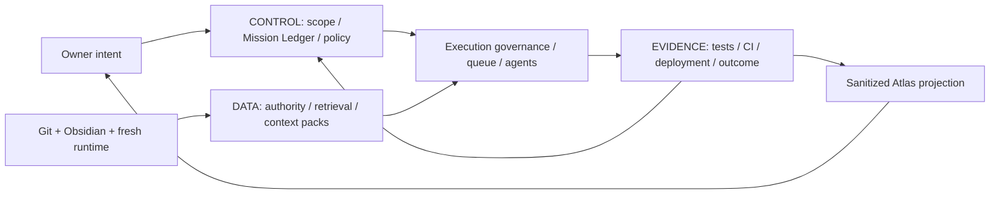
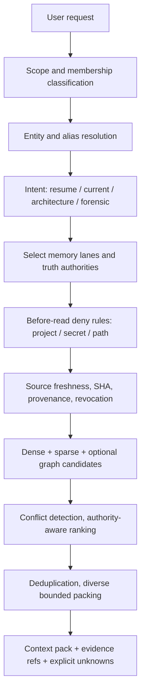
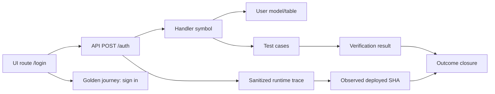
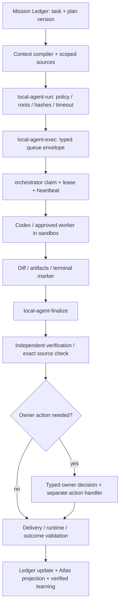
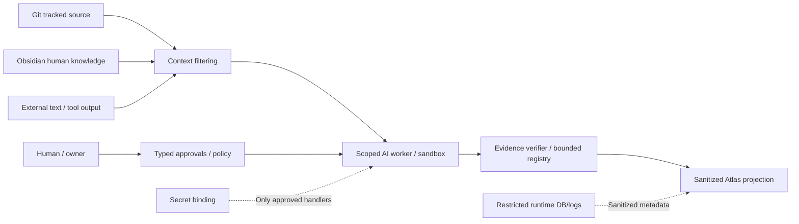
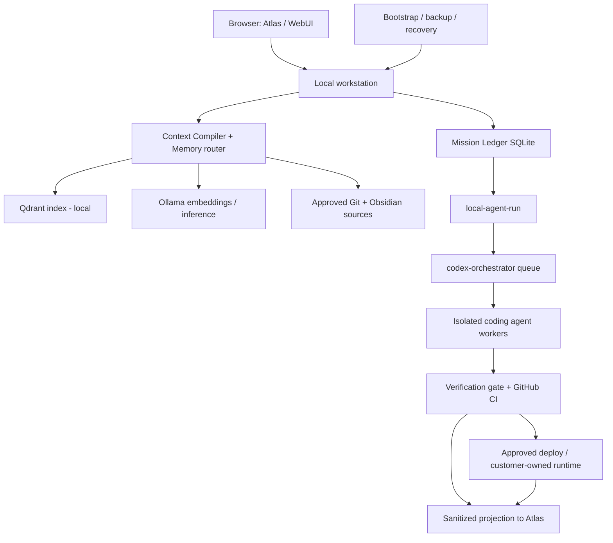

> **Область документа.** Подробный исследовательский справочник. Не является свидетельством реальной установки, доступной клиентам SaaS-подписки или проверенной экономии. Закрытые внутренние идентификаторы и конфигурации исключены. Цены и обещания поставки определяются текущим оффером, а не научно-техническими гипотезами.

# LOCAL AI OS — подробный технический и продуктовый справочник (публичная версия)
## Продуктовая стратегия, техническая спецификация и анализ конкурентоспособности

**Редакция:** аналитическая v1.0 от 19 ноября 2026 года; публичная адаптация от 20 ноября 2026 года.  
**Аудитория:** основатель, технический партнёр, заказчик-пилот, архитектурный ревьюер, инвестор/исследователь  
**Статус:** исследовательская спецификация, **не** доказательство существования выпущенного SaaS и **не** новый архитектурный authority  
**Источник фактов:** tracked source GitHub на 19.11.2026; независимый доступ к текущему host-runtime недоступен.  
**Границы:** публичная продуктовая поверхность и **строгое ядро System** различаются; внешние продукты пользователя не включены автоматически.

---

# ЧАСТЬ I. ПРОДУКТ: КОМУ И ЗАЧЕМ

## 1. Executive summary и ключевое решение

**Определение:** LOCAL AI OS — local-first, evidence-driven инфраструктура для долгосрочной AI-поддерживаемой разработки и управления инженерной работой. Она связывает намерение человека, авторитетные знания о проекте, свежий контекст, цель и версии плана, ограниченный запуск AI-исполнителей, независимую проверку, восстановление состояния и измеримый результат.

**Не является:** самостоятельной фундаментальной моделью; ещё одной IDE; генератором «бесконечного контекста»; универсальным агентом с неограниченным shell-доступом; доказанно автономной компанией; готовым многопользовательским облачным SaaS.

**Проверяемая продуктовая гипотеза:** покупатель готов платить не за наличие «памяти AI», а за уменьшение потерь времени при возобновлении и сопровождении длительных проектов, уменьшение повторной работы и ложных заявлений «готово», повышение безопасности передачи задачи нескольким агентам и доказуемое доведение согласованной работы до приёмки.

**Предлагаемое позиционирование:** **LOCAL AI OS — Project Continuity & Verified Delivery for AI-powered engineering**. На русском: «Система, которая сохраняет понимание проекта и показывает не только, что сделал AI, но и что действительно проверено и доставлено». Это позиционирование **предлагается**, а не объявляется существующим утверждённым оффером.

**Как продавать сегодня:** сохранять существующую продуктовую идентичность LOCAL AI OS и действующую узкую модель внедрения: диагностика **9 900 ₽**, зачёт в пилот **49 900 ₽**, **одна Linux-станция, до трёх проектов, пять рабочих дней**. Не создавать параллельный продукт/инсталлятор/прайсинг. Конкретный первый use case выбрать по платным диагностикам и фактическому измерению до/после. Вектор «SaaS для команды» остаётся будущей гипотезой.

**Состояние:** код и документы нескольких ключевых компонентов проверены через GitHub; их совместная live-работа, current-master CI, installation parity и коммерческие outcome здесь **не проверены**. Публичный founder proof сообщает 12 verified runs и 17 context-preflight runs без сопоставимого baseline; это **не** демонстрация прироста и **не** клиентский кейс.

## 2. Проблема покупателя и jobs to be done

### 2.1 Что ломается в AI-разработке

| Событие | Фактическая проблема | Сколько это может стоить | Что должен предоставить продукт |
|---|---|---|---|
| Возобновление работы через неделю | Контекст распался на чаты, PR, заметки, IDE и неполные задачи | Повторный анализ, ошибки в предположениях | Проверяемое состояние проекта и краткий continuation pack |
| Переход между разными AI-агентами | Новый агент не знает решений/ограничений и повторяет неудачные попытки | Rework, расход токенов и времени | Переносимый проектный контекст с происхождением и scope |
| «AI всё сделал» | Тесты, merge, deploy и live outcome смешиваются в одно «готово» | Ложные релизы, дефекты, проверки вручную | Отдельные оси статуса и evidence links |
| Несколько репозиториев | Непонятны зависимости, границы прав, критический путь | Конфликты, повторные PR, архитектурный дрейф | Единая карта контекста и управляемые поручения |
| Устаревшая или противоречивая память | RAG находит похожий, но неверный факт | Повторение дефекта, неверная диагностика | Authority/freshness/supersession gates |
| Работа на приватной станции | Исходники/секреты нельзя бесконтрольно отдавать облачному агенту | Security и compliance риск | Local-first, allowlists и явные approvals |
| Перезапуск/сбой хоста или агента | Теряются попытка, состояние и доказательства | Зависшая очередь, повторное выполнение | Устойчивые ID, lease/recovery и explicit blockers |

**Главная job-to-be-done:** «Когда я возвращаюсь к сложному проекту или делегирую работу агенту, мне нужно быстро восстановить достоверную картину, безопасно продолжить действия и увидеть доказательство конечного результата — без повторного объяснения всего с начала».

### 2.2 Основные роли и покупатели

1. **Первый ICP, соответствующий текущему продукту:** технический владелец Linux-станции и 1–3 приватных проектов, регулярно использующий Codex/Claude/Cursor/локальные модели, уже испытывающий дорогую потерю контекста или недоверие к восстановлению. Покупает диагностику и индивидуальное внедрение. **Это текущий подтверждённый контрактом сегмент**, но не подтверждённый покупками сегмент.
2. **Потенциальный следующий ICP:** небольшая AI-first команда 2–10 инженеров или студия разработки с несколькими агентами, десятками сессий и постоянными изменениями. Покупает снижение rework/длительности delivery. **Требуются интервью и multi-user продукт**, текущая поставка ещё не соответствует.
3. **Последующий enterprise-сегмент:** команды с приватным кодом, RBAC, audit trails, SSO, контролем и evidence traceability. Длиннее продажи, выше требования безопасности. **Не приоритет до первых платных пилотов.**
4. **Соседние варианты:** maintainer большого legacy-проекта, исследовательская инженерная группа, DevOps/SRE. Это гипотезы применимости, не отдельные обещания зрелости.

**Экономический покупатель** в первом ICP — сам технический собственник, во втором — CTO/engineering manager/руководитель студии. Пользователь — разработчик, технический лидер, владелец проекта. Различие важно: пользователь хочет удобную работу, покупатель — проверяемую экономию времени, рисков и затрат.

## 3. Где и как демонстрировать ценность

Не начинать демонстрацию с 11 слоёв или архитектурных графов. Показывать одну задачу **«продолжить работу после перерыва и довести её до доказанного результата»**.

### 3.1 Экран 1: состояние проекта

```text
Project: Billing Service
Goal: безопасно завершить переход на новую схему платежных событий
Current source: commit <SHA> / branch <branch>
Last accepted decision: сохраняем обратную совместимость до миграции клиентов
Known failed approach: прямое изменение схемы без compatibility adapter
Work: 4/6 задач терминальны; одна блокирована
Evidence: source PASS / unit PASS / CI UNKNOWN / deployed UNKNOWN
Next action: повторно проверить точный HEAD и восстановить тестовую среду
Scope: repository billing only; production deploy requires owner approval
``` 

Это **проектный UX-макет**, а не снимок реальной установки или утверждение о существующем экране.

### 3.2 Экран 2: задача и управляемое исполнение

Владелец формулирует результат. Система подбирает источники и объясняет, почему они включены; исключает устаревший коммит и запрещённые документы; сохраняет критерии приёмки; передаёт работу выбранному агенту с предопределёнными корнями записи и тайм-аутом.

### 3.3 Экран 3: доказательство завершения

```text
Task: исправление обработки webhook
Code produced: YES — commit <SHA>
Unit tests: PASS — exact source ref
Integration: FAIL — test #17, timestamp
PR merged: NO
Deployed: NO
User outcome: NOT MEASURED
Final status: BLOCKED, NOT DONE
Owner action: подтвердить исправление integration-test failure
``` 

Именно такой момент объясняет продукт лучше, чем фраза «умный AI помнит всё». **Критерий успеха демонстрации:** наблюдатель понимает, почему система отказалась назвать частичный результат готовым и какой следующий шаг нужен.

## 4. Данные о рынке (не TAM)

- GitHub Octoverse 2026 сообщает, что к сентябрю 2026 года **более 40% PR начинались с первой версии от AI-агента**, против 17% в марте. Это сигнал роста agent-assisted software engineering, а не оценка выручки сегмента LOCAL AI OS. [Источник](https://github.blog/news-insights/octoverse/octoverse-commits-pushes-reach-new-highs-in-2026-as-developers-build-with-agents/).
- Stack Overflow Developer Survey 2026: **65,9% респондентов** (11 509/17 464) указали использование AI coding assistants или coding agents в работе. Выборка опроса не эквивалентна всем мировым разработчикам. [Данные](https://survey.stackoverflow.co/2026/ai/data/ai-select).
- В отдельном вопросе SO Survey 2026 **48,0%** (6 872/14 304) отметили доверие к AI, когда могут легко проверить результат. Это релевантно evidence-first, но не показывает платёжеспособность. [Данные](https://survey.stackoverflow.co/2026/ai/data/ai-trust).

**Нельзя** получать TAM/SAM/SOM из 40% PR, 65,9% респондентов или числа аккаунтов GitHub простым умножением на предполагаемую цену. Для оценки SOM нужны данные о количестве подходящих Linux-владельцев, частоте больного сценария, конверсии в диагностику и реальной готовности платить. Сейчас они неизвестны.

### 4.1 Проверяемая экономика одного клиента

Иллюстративный сценарий, **не измерение и не обещание ROI**: если один технический владелец экономит 2 часа в неделю, а его час оценивается в 3 000 ₽, потенциально освобождается 2 × 4 × 3 000 = **24 000 ₽/месяц**. При цене пилота 49 900 ₽ простой бездисконтный срок покрытия стоимости — около 2,1 месяца **только если** экономия действительно измерена, сохраняется и имеет реальную альтернативную ценность. Для продаж учитывать стоимость самого внедрения, поддержку, риск ошибок, стоимость моделей и качество результата.

### 4.2 Эксперименты валидации спроса

- 10 проблемных интервью с техническими владельцами, без презентации архитектуры как ответа.
- По крайней мере 3 независимых описания одной повторяющейся дорогой проблемы собственными словами покупателей.
- Один платный диагностический контракт с исходным baseline, метрикой и отчётом.
- Сопоставимый before/after на реальной задаче; сбор времени человека, повторных попыток, затрат, состояния CI и результата.
- Проверка: согласен ли клиент повторно использовать решение / рекомендовать его / платить за поддержку.

Текущий `growth-readiness.md` прямо запрещает платный трафик, пока нет узкого подтверждённого внешнего сценария и клиентского доказательства.

## 5. Конкуренты и реальная дифференциация

### 5.1 Карта конкурентных классов

| Альтернатива | Что она уже закрывает | Где потенциальная роль LOCAL AI OS | Вывод |
|---|---|---|---|
| [Cursor Projects](https://cursor.com/docs/agent/projects) | Общий Agent Store, длительные проекты, правила, coordinator и агенты | Межинструментальный слой достоверности и приёмки, независимый от IDE | Нельзя продавать «у нас впервые появилась память проекта» |
| [Claude Code](https://support.claude.com/en/articles/14553413-claude-code-cheatsheet) | `CLAUDE.md`, hooks, subagents, сессионные инструменты | Связь с Ledger, кросс-сессионные evidence refs, live acceptance и product state | Базовая continuity уже массовая функция |
| [GitHub Copilot agents](https://docs.github.com/en/copilot/get-started/about-github-copilot) | Рабочие поручения, PR, review, GitHub-native automation | Контекст между источниками и границы за пределами PR | Нельзя утверждать, что конкуренты «только пишут код» |
| [Factory Missions](https://factory.ai/product/missions) | Планирование зависимостей, параллельные Droids, долгие задачи, shared knowledge | Независимый source/runtime/outcome truth, воспроизводимый локальный deployment | Один из самых близких прямых конкурентов |
| [Letta](https://docs.letta.com/configuration/memory) | Stateful agents, редактируемая долговременная память, MemFS | Память *проекта* под authority/freshness/acceptance, не только память агента | Сама долговременная память не уникальна |
| [Augment Context Engine](https://www.augmentcode.com/context-engine) | Релевантный codebase context и инженерные знания | Проверка и outcome loop поверх retrieval | Нельзя позиционировать RAG как новизну |
| [OpenHands](https://www.openhands.dev/) | Выполнение задач разными coding agents, локальная/удалённая среда, CI/PR | Governance и cross-source continuity с конкретными контрактами | Сильный конкурент в локальном execution |
| [LangGraph](https://github.com/langchain-ai/docs/blob/main/src/oss/langgraph/overview.mdx) | Durable execution, checkpoints, HITL, graph runtime | Готовое сквозное применение к engineering lifecycle, не новый graph runtime | Больше инфраструктурная альтернатива, чем «конкурент-клон» |
| Ручной набор GitHub + Obsidian + AGENTS.md | Недорого и контролируемо для сильного инженера | Снижение ручного toil только если измеримо превосходит baseline | **Главный конкурент первого пилота** |

На 19.11.2026 нет достаточного доказательства уникальности каждого отдельного алгоритма. Новизну можно защищать как **архитектурную комбинацию и её практическую эффективность на конкретном сценарии** при сравнительном benchmark.

### 5.2 Потенциальные отличия, которые имеет смысл проверять

**D1. Context с подтверждённым происхождением:** подбор источников не только по embedding similarity, но и по owner/scope, authority, freshness, supersession и секретным границам. Проверить против обычного top-k RAG и Cursor/Claude rules.

**D2. Долгая идентичность работы:** постоянные `mission_id → task_id → attempt_id → run_id` и lineage доказательств. Проверить на 20+ реальных перерывах, retries и сменах чатов/агентов.

**D3. Правда о завершении:** явное различие `code → tests → CI → merge → deployed revision → live outcome`. Проверить количество false-DONE на заранее подготовленных failure cases.

**D4. Earned autonomy:** увеличение прав на класс действий после shadow/canary/monitoring, а не глобальный переключатель «автономность». Проверить сложность настройки и предотвращённые опасные действия, а не только наличие JSON-политик.

**D5. Local-first без монопольного AI-поставщика:** Ollama/Codex/другие исполнительные пути с одной моделью доверия. Проверить реальные swap-сценарии и data egress.

**D6. Project Mental Model / Reality Graph:** ответ «что это значит для моего проекта» вместо простого поиска совпадающих фрагментов. Проверить accuracy причинных выводов на свежем и историческом состоянии.

**D7. Доказательная самоэволюция:** кандидат изменения skill/model/router допускается только после оценки и existing promotion authority. Проверить отсутствие regression и снижение стоимости результата.

**Тест защитимости:** нельзя называть D1–D7 moat, пока другие продукты не сравнены на одном наборе задач и не показано преимущество, важное для платящего клиента. Их текущее состояние — source-backed engineering approaches и гипотезы отличий.

## 6. Существующее коммерческое предложение, без переизобретения

Канонический `goringich/local-ai-os/docs/product-manifest.json` определяет продукт как **`productized implementation service`, stage `incubation`**. Не как действующий SaaS. Вход — founder-led диагностика одного повторяемого дорогого рабочего сценария. Поставка — documented scoped workflow, recovery boundary и sanitized acceptance report.

**Публичный proof:** `founder-context-control-001`, дата 13.07.2026, version 0.1.0; 12 verified runs и 17 context-preflight runs из локального агрегата. Отсутствуют сопоставимые duration/tokens baseline, минуты вмешательства человека и клиентская проверка. Поэтому не заявлять проценты улучшения.

**Верифицируемый путь развития коммерческой модели:** диагностика → пилот → принятие результата → повторное применение → поддержка/обслуживание → стандартизированный пакет установки → multi-seat/team management → hosted control plane при доказанной потребности. Каждый переход отдельный gate, а не автоматическая эволюция названия продукта.

---

# ЧАСТЬ II. ТЕХНИЧЕСКАЯ АРХИТЕКТУРА: ФАКТИЧЕСКОЕ ЯДРО

## 7. Граница состава: что система собой является

Строгое членство определяется `SYSTEM_SCOPE_START_HERE.md` и `system-state-allowlist.json`:

| Репозиторий/источник | Статус | Ответственность |
|---|---|---|
| `private System core` | **Core** | Control/cognition/context, Mission Ledger, execution governance, evidence contracts, research, runtime policies |
| `private execution queue` | **Core** | Очередь bounded execution, claim, lease, worker lifecycle |
| `host bootstrap layer` | Supporting | Restore, portability, installer/system maintenance |
| `private Project Atlas implementation` | Supporting **только** роль Project Atlas | Human UI и санитизированные проекции |
| `private human-knowledge authority` | Supporting knowledge authority | Human-readable цели, решения, история и runbooks |
| `goringich/local-ai-os` | **Внешняя к core продуктовая поверхность** | Сайт, оффер, proof/QA, customer-package contracts |
| TPS, Elizabet и прочие owner/commissioned repos | **Не входят в core по умолчанию** | Сопутствующие продукты/сервисы только с отдельным scope |

**Инвариант:** `GitHub доступен` ≠ `repo разрешён для чтения` ≠ `компонент System` ≠ `repo разрешён для изменения`. Product surface может продавать возможности ядра, но не переписывать его authority.

### 7.1. Границы публичной версии

Точные ссылки, идентификаторы приватных репозиториев, внутренние SHA и локальные сведения установки не публикуются. В действующем пилоте заказчик получает scoped архитектурный runbook, а не доступ ко всей персональной системе основателя.

## 8. Архитектура из трёх независимых плоскостей



- **Control plane** хранит *почему* и *что разрешено*: цель, правила, DAG, идентичность попытки, approvals и ограничения.
- **Data/context plane** обслуживает *что агенту известно*: исходные документы, версии, chunks, embeddings, свежесть, безопасность, контекстный бюджет.
- **Evidence/outcome plane** отвечает *что реально случилось*: команда и exit status, тесты, CI, deploy, runtime health, customer acceptance и результат, доказательства по SHA/времени.

Выделение плоскостей предотвращает несколько классов ошибок: summary не меняет цель, search-result не становится источником истины, агент не подписывает сам себе acceptance, браузерный dashboard не выполняет команды напрямую.

## 9. Все 11 уровней LOCAL AI OS

| Уровень | Смысл | Основные сущности | Граница |
|---|---|---|---|
| **L0 Personal OS** | База хоста и портируемость | Linux, system-bootstrap, sync, backups | Host health требуется измерять live |
| **L1 Human Memory** | Зачем и как принимались решения | Obsidian, Git-docs, ADR, runbooks | Не хранить raw private transcripts как истину |
| **L2 Operator Status** | Текущий health и next-action | `local-ai-os-status`, generated snapshots | Только проекция, не mission DB |
| **L3 Project Atlas** | Понятный человеку Mission Control | React UI, gateway, state projections | UI не становится владельцем Ledger |
| **L4 Context/CAG/RAG** | Корректная выдача релевантного контекста | scope classifier, RAG v3, context compiler, graph | Источники отбираются до чтения и индексирования |
| **L5 Mission/Portfolio** | Цели, планы и жизненный цикл | SQLite Ledger, immutable plans, task DAG | Единственный mission authority |
| **L6 Governed Entry** | Безопасный запуск работы | `local-agent-run`, preflight, worktree, hashes | Нельзя запускать вне разрешённых корней |
| **L7 Executors/Models** | Выполнение и lease/recovery | `codex-orchestrator`, Codex, route policies, Ollama | Worker не определяет собственные права |
| **L8 Evidence/Economics** | Качество, стоимость, доказательство | verification engine, telemetry, cost/owner time | Self-reported success не финальный факт |
| **L9 Sync/Integrations** | Переносимость и внешние адаптеры | system-sync, project sync, adapters | Не переносить локальные секреты и runtime DB в source |
| **L10 Machine-local Runtime** | Машинно-специфическое состояние | DB, WAL, queues, caches, keys, models, logs | Не экспортировать сырые данные публично |

Это **11 зон ответственности**, не заявление о 11 постоянно работающих сервисах. Наблюдаемая топология процессов, портов и версий на хосте требует отдельного live census.

## 10. Authority, source of truth и статус зрелости

**Единственное ответственное место на домен:**

| Домен | Authority |
|---|---|
| Решения с последствиями | Человек/владелец с typed approvals |
| Source code / версии | Git конкретного репозитория |
| Цели и оперативные задачи | Mission Ledger |
| Claims/leases/queue | codex-orchestrator |
| Подготовка code-changing работы | `local-agent-run` |
| Архитектурные объяснения | Obsidian и reviewed tracked contracts |
| Текущее состояние хоста | Свежие санитаризованные runtime attestations |
| PR/CI/ветки | GitHub соответствующего owning repo |
| Dashboard | Project Atlas как **read-only projection по смыслу**, не second DB |
| Retrieval index | Перестраиваемый Qdrant/индексы, не истина |
| Платёж/выручка | Внешняя платёжная/учётная authority с receipt и delivery linkage |

**Лестница доказательств:** `documented → source exists → source tested → exact-head CI → merged → installed → running → verified live → user outcome → commercial outcome`. Между ступенями нельзя ставить знак равенства. Стадия *unknown* предпочтительнее красивого, но ложного «done».


---

# ЧАСТЬ III. ПОДСИСТЕМЫ И ИХ ВНУТРЕННИЕ КОНТРАКТЫ

## 11. Память, knowledge management, retrieval и контекст

### 11.1. Почему это не «одна векторная база»

Память в System — **совокупность логически разных полномочий**, а не таблица embedding-векторов. Типизированный маршрутизатор `memory_control_plane.py` выбирает соответствующую память *до* поискового запроса. Его конфигурация — `local-codex-stack/configs/memory-control-plane-v1.json`, статус контракта `adopted`; программный компонент присутствует в tracked source. Регистры и вспомогательные индексы **не получают права переписывать Git, Obsidian, Mission Ledger или live state**.

| Класс | Основное содержание | Authority | Типичный вопрос | Правило актуальности |
|---|---|---|---|---|
| **Working / continuity** | цель, важные решения, блокеры, следующая операция, lineage сессий | Conversation Continuity | «Продолжи с места остановки» | checkpoint привязан к evidence, новый checkpoint замещает старый active state |
| **Semantic current-state** | извлечённые фрагменты разрешённых документов и актуальных фактов | Git / Obsidian / live-authority, индекс Qdrant лишь копия | «Где определена текущая политика?» | source SHA, TTL, authority, supersedes/revoked |
| **Procedural / experience** | проверенные способы исправления, условия применимости, неудачные паттерны | Solution Memory / Experience Memory | «Мы уже исправляли это?» | опыт — candidate, не заменяет повторную проверку |
| **Entity / relationship** | сущности, алиасы, связи между узлами и репозиториями | entity registry + Local Knowledge Graph | «Что такое codex-smart и чей это компонент?» | точное scope/ownership resolution |
| **Architecture navigation** | карты компонентов, зависимости, границы и owner | System Universe / Architecture Observatory | «Как устроена вся система?» | граф — derived projection, source authority выше |
| **Historical forensic** | исторические сеансы, старые доказательства, неактуальные эксперименты | отдельный архив; opt-in | «Что происходило до регрессии?» | не смешивать с current-state retrieval, raw не импортировать автоматически |

Это принципиальная продуктовая возможность: *вопрос «что было?» и вопрос «что правда сейчас?» должны иметь разные пути выполнения*. Высокая релевантность фрагмента в embedding-пространстве сама по себе не делает его достоверным, свежим или разрешённым.

### 11.2. Входной алгоритм поиска



**Порядок проверок существенен.** Предлагаемая локальная последовательность: (1) выяснить владельца запрашиваемой информации, (2) запретить запрещённый проект до чтения файлов, (3) разрешить субъект/алиас, (4) классифицировать тип факта, (5) прочитать только допустимые источники, (6) проверить свежесть и происхождение, (7) получить кандидатов поиском, (8) устранить конфликты, (9) собрать компактный пакет. Нельзя делать «проиндексировать всё, а потом фильтровать» — это создаёт риск уже на стадии ingest.

### 11.3. RAG v3: устройство существующего исходного контура

**Исходники:** `scripts/rag-v3.py`, `local-codex-stack/configs/rag-v3.json`, архитектура `09-rag-v3-production-memory.md`.

Реализация и конфигурация описывают следующий pipeline:

1. **Source inventory:** перечень разрешённых source roots и Git-tracked файлов; для отдельных проектов применяется scope `project:<id>` и запрет на внешние заказные проекты.
2. **Deny before read:** исключение credentials, secret-like имён, raw logs, транскриптов, запрещённых каталогов, symlink escapes и нерелевантных проектов.
3. **Redaction & classification:** очистка допустимого содержимого и добавление метаданных чувствительности, источника, scope, времени и авторитетности.
4. **Structure-aware chunking:** Markdown режется по заголовкам/секциям; код — по символам или небольшим строковым окнам; section/document остаётся родителем чанка.
5. **Stable identity & indexing:** идентификаторы документа и чанка завязаны на canonical source/структуру/версию; хранится content/source hash.
6. **Hybrid search:** плотная embedding-ветка и **независимая** разреженная lexical-ветка. Семантические кандидаты не должны зависеть от предварительного совпадения ключевого слова.
7. **Fusion:** Reciprocal Rank Fusion (RRF) над ранжированными кандидатами разных семейств; отдельный reranker — только после benchmark на holdout.
8. **Authority & freshness re-ranking:** найденное не автоматически считается правильным; stale, revoked и wrong-project факты запрещаются в соответствующих режимах.
9. **Bounded expansion:** при вопросе о зависимостях возможен ограниченный проход по graph, а не бесконечный обход.
10. **Context packing:** разнообразные релевантные родительские секции, лимит на один документ, дедупликация, учёт токенов и явные missing/conflicting evidence.

Конкретные значения **из конфигурации**, но не измерения реального сервиса:

| Параметр | Source contract |
|---|---|
| Backend | Qdrant, localhost `127.0.0.1:6333` |
| Collection | `local_ai_knowledge_v3`, отдельный forensic namespace |
| Embeddings | Ollama, baseline `nomic-embed-text:latest` |
| Sparse | детерминированный hashed lexical vector, размерность 1 048 576 |
| Fusion | RRF |
| Candidate selection | prefetch 64, fused 16, final 8 |
| Chunking | target ~1 800 символов, max 3 200 символов, overlap 4 строки |
| Изменения | incremental idempotent indexing по source/content hash |
| Metadata | `source_sha256`, `content_sha256`, `authority_tier`, `freshness`, `scope`, `project_id`, `revoked`, `expires_at`, `index_schema_version` |
| Zero-tolerance eval | 0 forbidden project leaks, 0 stale-as-current, 0 revoked-as-current, 0 secret-boundary bypass |

При недоступном Qdrant предусмотрен **явно деградированный** bounded fallback. Он может помочь ответить на вопрос, но не имеет права возвращать фиктивный статус `healthy hybrid retrieval`. Изменение embedding model или схемы индекса требует контролируемой перестройки; удалённый source должен удалять соответствующие индексные точки. `rag-v3.json` описывает свой статус как `implementation`; текущая работа Qdrant и качество retrieval на 19.11.2026 не подтверждены живым тестом.

### 11.4. Бюджеты и context engineering

Контекст — **выбираемый рабочий набор**, не архив. В конфигурации RAG указаны профили генерации, которые нельзя путать с максимальным окном модели:

| Профиль | Контекст модели (`num_ctx`) | Максимум полезного retrieved контекста |
|---|---:|---:|
| fast | 4 096 | 3 500 токенов |
| coding | 8 192 | 7 000 токенов |
| architecture | 12 288 | 10 000 токенов |
| forensic | 16 384 | 14 000 токенов |

В Conversation Continuity отдельно задан бюджет восстановления логического потока: **~3 500** грубых токенов checkpoint, **~2 500** для недавних сообщений при доступности, **~9 000** targeted retrieval и **~16 000** суммарно. Это планы сборки контекста, не гарантированное снижение токенов на произвольных задачах.

Для каждого контекстного пакета должен быть понятен *почему он включён*: task scope, список источников, authoritative commit, source freshness, retrieval profile, исключения, доля бюджета и признаки конфликтов. Желательное UX-представление — «использовано 7/8 источников, один устарел, два запрещены по scope» вместо простого «AI всё знает».

### 11.5. Conversation Continuity: идентичность работы ≠ идентичность чата

Главная проблема долгих проектов: физическая сессия ChatGPT или Codex заканчивается, но работа **не должна терять свою идентичность**. Архитектура хранит `logical_thread_id` независимо от идентификаторов физического чата. Критические поля checkpoint: цель, scope, текущий workstream, ключевые решения и их основания, завершённое, невыполненное, блокеры, следующий шаг, тесты, `evidence_refs`, изменённые surfaces, superseded state.

**Механика:**

- Immutable checkpoint chain с `previous_hash`/content hash обеспечивает прослеживаемую эволюцию.
- Per-thread exclusive lock предотвращает concurrent lost updates от двух физических сессий; отдельный registry lock защищает mapping потоков.
- Допускаются incremental checkpoints и явные `replace_fields`/`remove_items`, а не бесконтрольное суммирование summary поверх summary.
- Continuation compiler собирает только hot state и ссылки на первичные факты; сжатие не должно удалять критический блокер или next action ради прохождения токен-бюджета.
- Raw conversations остаются в отдельном forensic контуре, без автоматического экспорта в рабочую память.
- Локальное хранение: директории `0700`, файлы `0600`, запрещена публикация raw state.

**Пример продуктового UX:** спустя месяц инженер открывает проект и видит «Последнее доказанное состояние: исправление собрано на SHA X; локальные тесты пройдены; production deploy не подтверждён; повторить release verification после обновления remote head; приоритетный блокер — Y». Это целевой пользовательский путь; только наличием checkpoint-кода нельзя подтвердить, что он прошёл live во всех инструментах.

### 11.6. Learning / solution reuse без «самовнушения» модели

Проверенный способ исправления может получить представление вида: `problem_signature`, `conditions`, `solution_reference`, `verification_evidence`, `failure_modes`, `invalidating_conditions`, `reuse_outcome`. Это **семантическая форма**, не утверждение о буквальных полях одной таблицы. Опыт должен ссылаться на точное evidence и допускать отрицательные примеры. Новая попытка сверяется с актуальной версией кода и runtime; старый успешный фикс не становится безусловным приказом. Consolidation в Memory Control Plane имеет режим `proposal_only`: кандидат проходит conflict/secret/provenance gate, затем его принимает **владелец канонического источника**.

### 11.7. Метрики памяти и воспроизводимые критерии

Нужны отдельные измерения: entity resolution accuracy; recall@k; MRR и nDCG; context precision/recall; правильность authority; stale-current error; запрещённый leak; latency p50/p95; длина пакета; фактическая доля задач, в которых recovered memory изменила outcome. В публичных документах есть **локальный fixture-результат** повышения hit@1 с 0,6667 до 1,0 и MRR с 0,8241 до 1,0 на тестовом наборе от 15 июля 2026 года, а также наблюдаемый низкий ratio контекстного pack 0,0862 (~11,6× относительно конкретной исходной длины). Без размера, выбора и статистики набора нельзя переводить это в маркетинговое утверждение «в 11,6 раза меньше токенов у всех клиентов».

## 12. Смысловая модель проекта, digital twin и графы

### 12.1. Project Mental Model — смысл, а не файловый поиск

`local-codex-stack/scripts/project_mental_model.py` компилирует **проекцию понимания** зарегистрированного проекта из project-owned источников. Семь логических разделов:

1. **WHY** — назначение, заинтересованные стороны, ожидаемая польза.
2. **WHAT** — устройство проекта, продуктовый и delivery contract.
3. **REALITY** — наблюдаемое состояние и реальные проблемы.
4. **QUALITY** — проверенные сильные стороны, осознанные компромиссы, технический долг.
5. **GAPS** — расхождение цели и фактов, неизвестные причины, просроченное evidence.
6. **DELIVERY** — что можно показать сейчас и какой следующий *демонстрируемый* результат.
7. **EVIDENCE** — точный Git HEAD, возраст и происхождение данных, conflicts и unknowns.

Проект при желании хранит `docs/state/project-model.json` как **добавочные интерпретационные данные**. `docs/product-manifest.json`, source code и project-owned runtime остаются приоритетными authorities. Пустые strengths/tradeoffs не заполняются искусственно ради «идеального дашборда».

### 12.2. Project Reality Graph — как продукт реально связан с кодом

Источник `local-codex-stack/docs/architecture/18-project-digital-twin.md`. Сущности: project/repo/source file/symbol/UI route or state/API operation/data model/test/user journey/runtime service/trace. Типовые рёбра: `CONTAINS`, `DEFINES`, `IMPORTS`, `RENDERS`, `CALLS`, `HANDLED_BY`, `READS_WRITES`, `VERIFIED_BY`, `PART_OF_JOURNEY`, `OBSERVED_IN`, `DEPLOYED_AS`, `NEXT_STEP`.

Это позволяет ответить не просто «где файл?», а: *«Как изменение формы авторизации затронет маршрут /login, API, модель данных и соответствующий пользовательский тест?»*



Граф допускает **многоуровневое происхождение ребра**: explicit declared contract выше source parser, а regex/heuristic ниже compiler-accurate reference. Существующая реализация описывает bounded extraction Python symbols/imports, TypeScript/JavaScript imports/symbols, Express/Fastify/FastAPI/Flask routes, OpenAPI, Prisma, SQL, тестов. Высокая полнота в произвольном monorepo не установлена без benchmark по языкам и фреймворкам.

### 12.3. Golden Journeys и фактические трассы

Golden Journey — явно определённый *пользовательский маршрут*, например «пользователь регистрируется → входит → создаёт документ → получает подтверждение сохранения». У маршрута должны существовать test identifiers и, когда необходимо, **наблюдение runtime**. Метаданные traces могут включать trace/span ID, method/normalized route, HTTP status, timestamp, duration, service, `source_sha`/`deployment_sha` и bounded error-class. **Нельзя** централизованно принимать raw request bodies, `Authorization`, cookies, customer rows или HAR.

Успешный UI screenshot не доказывает полный end-to-end пользовательский маршрут. Исходник с маршрутами не доказывает, что API отвечает. Наличие runtime trace не доказывает бизнес-эффект. Связка создаёт возможности для доказательного объяснения пользователю, но её полнота и надёжность — предмет live приёмки.

### 12.4. Unified Intelligence Graph — много источников, но не второй источник истины

Композитор объединяет Obsidian knowledge graph, Architecture Observatory, Mission Ledger State Graph, Project Reality Graph и согласованные semantic links RAG v3. Выход — read-only projection с явным `projection_is_authority: false`.

Отношения имеют классы: dependency, containment, ownership, execution, data_flow, verification, observation, knowledge, semantic, causal, deployment, security_boundary, association, unknown. **Только dependency, execution, data_flow и causal по умолчанию распространяют impact**. Если два документа семантически похожи, это **не** означает, что изменение одного вызовет поломку другого. Граф ограничивает обход обычно шестью hops; missing edge или неизвестная категория не преобразуется в выдуманную причинность.

### 12.5. Что здесь может быть научно новым

Не сами графы. Возможная исследовательская гипотеза: **проверяемая комбинация временной модели проекта (источники/версии), причинно типизированных связей, retrieval по authority и реальных тестовых evidence уменьшает ложные рекомендации по сравнению с baseline code search или одним RAG**. Чтобы доказать её, нужно сопоставимое evaluation на real repositories с ground truth. Пока это область исследования, а не новшество, подтверждённое peer review.

## 13. Mission Ledger: долговременная цель, версии плана и машинное состояние

### 13.1. Владелец и хранение

Оперативное хранилище — **SQLite Mission Ledger** (исходник `local-codex-stack/scripts/ai_company_ledger.py`, миграции `local-codex-stack/migrations/ai-company/`). Runtime база предназначена для локальной машины: `runtime/local-codex-stack/ai-company/ledger.sqlite3`, с SQLite WAL/SHM при соответствующем режиме. Git содержит schema/migration/policy, **но не** runtime DB. События связаны history/revision/hash chain; точная правовая пригодность или tamper-proof надёжность не подтверждена независимым аудитом.

### 13.2. Объектная модель

```text
Mission (objective / outcome contract)
 ├─ plan_version 1, 2, 3 ... (immutable versions)
 │   └─ workstream (bounded result)
 │       └─ task_id (stable logical identity)
 │           ├─ attempt_id A → run_id A → evidence → verdict
 │           ├─ attempt_id B → run_id B → evidence → verdict
 │           └─ attempt_id C → run_id C → evidence → verdict
 ├─ owner decisions / approvals
 ├─ dependencies / blockers / risks
 ├─ artifact and deployment references
 └─ business or user outcome evidence
```

**Главный инвариант:** `task_id` живёт до терминального результата самой задачи; новый retry **создаёт attempt**, а не новую задачу, и не стирает историю. Версия плана immutable и предыдущая версия явно `superseded`, что важно при изменении требований.

### 13.3. Outcome contract

На концептуальном уровне у миссии должны быть `goal`, `scope`, `baseline`, `success_conditions`, `accepted_evidence`, `budget`, `risks`, `rollback`, `owner_gate`. Здесь названия — аналитическая форма контракта, не обещание literal SQL column names. Более безопасная модель: одна задача может быть `work=completed` и `implementation=verified`, но `deployment=pending`, а `outcome=not_measured`. Нельзя считать такой проект «полностью доставленным».

**Матрица состояний:**

| Независимая ось | Допустимые состояния из source docs |
|---|---|
| Work | pending, running, blocked, completed, failed, canceled |
| Implementation | unverified, partially_verified, verified, rejected |
| Deployment | not_planned, pending, approved, deployed, failed, rolled_back |
| Outcome | not_measured, observing, observed, achieved, not_achieved, unavailable |
| Evidence | pending, verified, partially_verified, unverified, rejected, stale |
| Atlas availability | available, unavailable, unknown |
| Atlas freshness | fresh, stale, unavailable, unknown |

Эта модель решает источник распространённых ошибок AI-разработки: искусственное сокращение нескольких неэквивалентных фактов до одного булева `done: true`.

### 13.4. DAG, зависимости, критический путь

Задачи одной миссии образуют план с направленными зависимостями; параллельный запуск допустим только для независимых узлов с разрешённым ресурсным scope. Переход от плана к запуску содержит checks: владение репозиторием, preflight, достаточность evidence, отсутствие занятого/конфликтующего resource, бюджет и соответствующую authority. Рекомендации planner/portfolio не должны порождать вторую систему задач за пределами Ledger. Это предотвращает конкурирующие списки задач, дублирующие issue и гонки при параллельных исполнителях.

### 13.5. Событие и восстановление

Требования к корректной state machine:

- атомарность изменения состояния/события;
- idempotency при повторном webhook или завершении worker;
- явное lineage предыдущих версий;
- различение `blocked`/`unknown`/`failed`;
- невозможность скрыть незакрытые approvals и блокеры;
- проверка восстановленного backup и согласование миграций;
- replay / reconciliation, не создающие новую «истину» из projection-файла.

Это требования контрактов и анализа отказов; транзакционную реализацию каждого перехода надо подтверждать конкретными source-tests и runtime drill, а не только этим описанием.

## 14. Governed Execution: передача задачи AI, очередь и безопасное выполнение

### 14.1. Execution spine

Система намеренно не предоставляет AI-агенту unrestricted shell только потому, что пользователь ввёл запрос. `local-agent-run` — **единая точка разрешённой работы с кодом**: проверяет scope, builds context pack, выделяет allowed roots, создаёт изолированную worktree/sandbox по правилам, задаёт timeout, budget, evidence requirements, идентичность run и hashes подготовленных inputs. `local-agent-exec --dispatch queue` создаёт ограниченный envelope, который исполняет уже другой owner — `codex-orchestrator`.

Канонический поток:



### 14.2. Queue и lease semantics

`codex-orchestrator` владеет queue/claim/lease/heartbeat/terminal markers. Envelope v2 предусмотрен для связки `mission_id`, `plan_version`, `workstream_id`, `task_id`, `attempt_id`, `run_id`, role, roots, evidence, budget, timeout и hashed prompt/context. Буквальное содержимое private prompt остаётся в локальной ограниченной области и не экспортируется как queue status. Исторические envelope v1 совместимо читаются, но непрозрачный legacy-marker нельзя насильно приклеивать к современной миссии.

**Типовые режимы гонки:**

- Worker умер после claim — lease истекает; recovery не должен помечать старую попытку успешной без terminal evidence.
- Worker завершил задачу, но network transport повторил notification — нужен повторный reconcile вместо двойного merge/deploy.
- Старый terminal marker остался после новой попытки — он должен быть отклонён по attempt/run identity.
- Два AI изменяют один ресурс — изоляция worktree и существующая политика merge/ownership; отсутствие конфликта файлов ещё не означает отсутствие semantic conflict.
- Queue item испорчен — quarantine/typed terminal fail, не выполнение произвольной строки.
- Worker вернул `exit code 0`, но acceptance test не прошёл — task result остаётся неполным.

В текущем head `codex-orchestrator` последний описанный коммит посвящён отклонению устаревших terminal markers от чужих попыток. Исторический архитектурный snapshot упоминает queue-v2 staged/not deployed; **это не свежая проверка** текущего установленного worker. Production parity требуется измерять отдельно.

### 14.3. Model routing и полномочия

Policy выбирает **подходящего исполнителя для роли** — coding, research, review, QA, analysis — по availability, качестве на representative eval, latency, стоимости, ресурсам и разрешённому окружению. Модель не становится authority, если она даёт лучшие ответы. Успешная model eval не даёт разрешение на публикацию, deployment, оплату или изменение firewall.

Logical agent role — это декларация. Реальная доступность требует свежего worker capacity evidence. Возможность подключить ChatGPT, Claude Code, local Ollama workers или браузерный агент не доказывает, что все одновременно работают на текущей машине.

### 14.4. Approval — решение, не команда

Typed approval фиксирует actor, действие, разрешённый scope, risk class, expiry, допустимую reversibility и origin. После одобрения **отдельный action handler** должен повторно проверить актуальное состояние, binding и политику перед выполнением. Самого значения `approved` недостаточно, чтобы считать изменение в production сделанным. Категории ограничений: удаление, расширение прав, секреты, внешние публикации и контакты, деньги, DNS/VPN/network, релизы и иные невосстановимые/существенные действия.

## 15. Verification Engine и доказательность результата

### 15.1. Source-контракт

`local-codex-stack/scripts/ai_company_verification.py` реализует engine для независимой проверки. Registry `local-codex-stack/configs/ai-company-verification-policy.json` содержит ограниченные **command identifiers**, разрешённые working directories, типы evidence и timeout. Вызывающий не вправе передать произвольный `argv`, `shell` или `cwd`. Режим выполнения использует `subprocess.run(..., shell=False)` с разрешёнными параметрами. Тем самым текст агентского ответа не является executable code в verifier.

Запись proof должна связывать `type`, `ref`, `hash`, identity тестовой команды, `exit status`, timestamps, environment, producer/verifier, freshness и краткую sanitized summary. Проверка доказательства включает принадлежность нужному source SHA и environment, TTL, provenance и соответствие acceptance criterion. Неизвестное evidence означает `unknown/unverified`, **не** `pass`.

### 15.2. Как не потерять причинность между кодом и продакшеном

```text
Source patch / branch
    ↓  code review + unit / integration tests
Exact commit SHA
    ↓  exact-head trusted CI
Merged commit SHA
    ↓  approved release / artifact digest
Installed release SHA
    ↓  runtime health + real-browser/API tests
Serving runtime revision
    ↓  customer-visible journey + independent observation
Accepted outcome
    ↓  payment/retention etc, when commercially relevant
Business effect
```

Отдельный вопрос в каждой стрелке: *какая authority наблюдала событие, какой SHA, в какое время, на каком окружении, и достаточно ли evidence для перехода именно этой ступени?* Например, GitHub CI успешен, но клиент видит старый UI: `build=pass`, `runtime_revision=stale`, `user_outcome=not_achieved`. Такой результат не должен превращаться в «всё готово» только потому, что workflow завершился зелёным.

### 15.3. TTL и актуальность

Текущий source policy содержит примеры TTL (они **конфигурация**, не обещание универсальной корректности): `unit_test`, `integration_test`, `typecheck`, `build`, `browser_test` — 86 400 секунд; `commit` — 604 800; `runtime_health`, `api_response`, `deployment_check`, `telemetry_measurement` — 3 600. Со временем evidence устаревает и может потребовать recheck перед утверждением о live-state. Для строго релизной проверки одной TTL недостаточно: обязательно сравнить exact identity, route, service и production revision.

### 15.4. Independence vs self-review

Защита от ложного успеха включает разделение ролей: `author != sole reviewer`, `evidence producer != sole verifier`, `planner != outcome verifier`, `security worker != authority approver`. При малом числе моделей независимость по именам агентов не гарантирована: для критичной задачи нужен проверяемый отдельный acceptance protocol, а не «та же модель сама себя похвалила».

### 15.5. Примеры false-terminal, которые обязаны ловиться

| Ситуация | Правильное решение |
|---|---|
| PR создан, CI не запущен | `source_changed`, `verification=unknown` |
| CI pass на SHA A, рабочая ветка уже SHA B | `exact-head verification required` |
| Тесты зелёные, но сервис не развёрнут | `implementation=verified`, `deployment=pending` |
| Сервис доступен, но отдаёт старую версию | `runtime_revision mismatch`, не `verified_live` |
| Restore archive создан, восстановление не тестировали | `backup_exists`, `restore_test=unverified` |
| Платёжная кнопка присутствует, подтверждённой оплаты нет | `checkout surface exists`, `revenue=unknown/0 only with authority` |
| Пользователь получил PDF, но физическая печать не выполнена | digital artifact delivered, physical acceptance not achieved |


## 16. Model layer и экосистема локальных/удалённых AI-моделей

### 16.1. Роли компонентов

| Компонент | Техническая роль | Явная граница |
|---|---|---|
| **Ollama** | локальное размещение/выполнение LLM и embedding моделей через API | доступность конкретной модели должна быть измерена runtime; список в заметке недостаточен |
| **Open WebUI** | человеко-ориентированный интерфейс локальных моделей, knowledge/RAG сценариев | UI не владеет канонической памятью, полномочиями работы с кодом или Mission Ledger |
| **OpenClaw** | guard/router для помощника и интеграций, включая Telegram, в пределах принятых политик | не получает blanket shell, секреты или права вне scope |
| **OpenHarness** | terminal checks / испытание локальных моделей и инструментов | экспериментальный результат не равен production роли |
| **Codex + `codex-smart`** | coding-agent и управляемый вход/подбор контекста | нельзя подменять canonical command собственным shim без policy parity |
| **`codex-orchestrator`** | task queue, leases, workers, outcome markers | не становится planner/mission database, не выбирает стратегию компании |
| **model decision/routing** | выбор модели под задачу, budget, resources, качество, доступность | benchmark-driven promotion, fallback, rollback; не владеет разрешениями |
| **Optional research adapters** | потенциальные Hermes/MetaClaw/browser R&D | staged ≠ installed ≠ product-ready; нельзя перечислять как обязательные сервисы |

LOCAL AI OS — **model-agnostic в архитектурном смысле**: модели могут меняться, но задачи/доказательства/доступы имеют собственные стабильные идентификаторы. Это не означает, что все облачные провайдеры уже имеют production-certified adapter или одинаковые режимы доступа.

### 16.2. Выбор модели: качество на outcome, не только throughput

Техническое требование к model routing:

```text
capability + security scope + hardware availability
    ↓
role-specific candidates with version/digest
    ↓
representative evaluation (same tasks, same acceptance criteria)
    ↓
quality + p95 latency + GPU fit + direct cost + retries
    ↓
shadow / bounded pilot
    ↓
existing promotion authority
    ↓
observe regression / rollback
```

**Целевые метрики:** терминальный success rate, false-terminal rate, rework count, human intervention count, wall clock per verified outcome, cost per verified outcome, model latency, VRAM usage и нагрузка на workstation. Выигрыш токенов без выигрыша в конечном результате не является доказательством экономического преимущества. Локальный inference тоже стоит электроэнергии, GPU-времени, обслуживания, ожидания и риска ошибок.

### 16.3. Модельная топология и GPU

Исторические конфигурации RAG описывают одну видеокарту, ограничение loaded models и localhost-only Ollama. Не следует хардкодить модель/VRAM/port/driver пользователя как минимальное требование **коммерческого продукта**. Для клиента нужны compatibility probes, профили CPU/GPU/cloud, fallback при отсутствии локальной модели и документированная политика удалённого API.

Локальная установка может иметь физически разные компоненты: UI/agents на workstation; Qdrant/Ollama loopback; GitHub remote service; внешние LLM APIs при разрешении. Для одновременной модели, Ollama, IDE и браузера необходим headroom policy, а не максимальная заполненность VRAM. GPU cache tuning, Flash Attention, KV cache и model batching допускаются только после representative benchmark и с понятным откатом.

### 16.4. Небольшое, но принципиальное UX-правило

Пользователь должен видеть *какая модель выполнила работу и почему она выбрана*, но не обязан управлять каждой моделью руками. Если модель не отвечает, задача переходит в `blocked/degraded` или на разрешённый verified fallback, сохраняя `task_id`, а не «тихо» меняет требования или класс допуска.

## 17. Project Atlas: UI, состояние, API и роль человека

### 17.1. Existing implementation surface

Репозиторий `private Project Atlas implementation`, React/Vite frontend, local gateway и generated snapshots. `src/App.tsx` перечисляет рабочие пространства:

1. **Обзор / Today** — что важно, где система ждёт решения;
2. **Company / Mission** — миссии и portfolio gates;
3. **Revenue / Money** — отдельный коммерческий контур и уровень доказанности;
4. **AI Control / System** — runtime, retrieval, context, trust;
5. **Проекты / Work** — репозитории, progress, release и ownership;
6. **Запуски / Runs** — попытки, инструменты, traces, verification;
7. **Админки / Control** — санкционированные административные адаптеры;
8. **Remote / Ops** — ограниченные remote/host views без захвата чужой mutation authority.

`Project Atlas` — **human-facing projection**. Состояние не должно жить только в React state или в `snapshot.json`; пересоздание snapshot из Ledger/authority не должно менять истинный outcome. Производный snapshot имеет timestamp, schema, SHA, completeness и freshness, а при stale должен показывать предупреждение или fail-closed readiness, а не зелёный статус.

### 17.2. Что уже явно известно о gateway

Документация `home-admin/README.md` описывает `/api/health`, `/api/company/state`, release SHA и строгую проверку snapshot freshness/source completeness. Health становится 503, если отсутствует доказуемая точная версия релиза или snapshot непригоден. Есть source-only/browser acceptance `npm run accept:live -- --base-url ...`, но само наличие такой команды не свидетельствует о прохождении acceptance на рабочей машине.

Нюанс: архитектурный контракт требует проекционный UI, но отдельные исторические маршруты `POST /api/local-agent/dispatch`, `POST /api/remote/action` и typed approval proxy были зарегистрированы в interface catalog. Это **известная зона архитектурного drift**: UI нельзя в презентации безусловно называть полностью немутирующим. Мутации должны оставаться в существующих owner-approved handlers и иметь явно установленную authority; не надо дублировать queue внутри Atlas.

### 17.3. Предлагаемая пользовательская модель экрана (продуктовая гипотеза)

```
PROJECT OVERVIEW — Example SaaS
───────────────────────────────────────────────────────
Цель: уменьшить время завершения оплачиваемого заказа
Источник цели: project manifest@sha · версия 3

Текущее состояние:
  Код:       VERIFIED          (head sha: abc…)
  CI:        PASS              (exact head)
  Release:   NOT DEPLOYED      (approval required)
  Prod:      UNKNOWN           (no fresh runtime evidence)
  Outcome:   NOT MEASURED

Контекст:
  8 разрешённых источников · 2 изменились · 1 stale
  Последнее решение: не менять контракт внешнего API

Следующий проверяемый шаг:
  Повторить release gate → запросить approval →
  deploy → проверить customer journey

Вмешательство человека: Approve production release
```

**Это макет требований к подаче, не скриншот текущего продукта.** Для buyer demo надо либо показать реальное проверенное окружение Atlas, либо явно маркировать interactive prototype как simulation, не подменяя им telemetry.

### 17.4. UX-обязательства продукта

Для каждого важного статуса показывать: результат, степень доказанности, age/TTL, responsible authority, linked source evidence, blocked reason и recommended next permitted action. Пользователь должен понять разницу между «AI считает сделанным» и «сервис работает у клиента». Наиболее важные элементы UX — красные/unknown blockers, evidence timeline, dependency explorer, one-click *view* proof и точные owner approvals, а не объём графа архитектуры.

## 18. Security architecture, privacy и threat model

### 18.1. Trust zones



Первичные зоны: reviewed tracked source, generated runtime, restricted credentials, UI/browser, typed server handlers и внешний мир. **Текст внешнего источника — данные, а не инструкция к смене прав**. Система не должна доверять документу только из-за того, что он найден RAG; prompt injection в README, issue или веб-странице не должен расширять agent scope.

### 18.2. Основные угрозы и оборонительные механизмы

| Угроза | Последствие | Обязательный защитный механизм | Чем проверить |
|---|---|---|---|
| Prompt injection в retrieval | агент выполняет чужие указания | data/instruction boundary, policy отдельно от retrieved text, bounded tool whitelist | adversarial poisoned-doc cases |
| Утечка секретов в index/context | токен попал в LLM/публичный snapshot | deny-before-read, redaction, secret scan, запрещённые raw roots | secret canaries, negative tests |
| Внешний проект попал в System | нарушение NDA/изоляции | explicit membership and project scope; reject before read | forbidden-project leakage=0 |
| Старое решение считается текущим | ошибочное изменение архитектуры | SHA, TTL, revocation, authority ranking, live freshness | stale-as-current benchmark |
| Агент выдаёт CI за production | ложный успех | многоосевые states, exact SHA/runtime evidence | false-terminal challenge set |
| Повторное выполнение команды | двойная mutation | task/attempt/run identity, idempotency, lease claim, finalizer | duplicate dispatch/crash injection |
| Dashboard выполняет arbitrary shell | выход из trust boundary | typed commands, no shell/argv from browser, guarded handler | API negative tests, route inventory |
| Подмена release/entitlement | supply-chain compromise | Ed25519 signatures, pinned public trust anchor, sha256, SBOM/provenance | tampered package fixtures |
| Повреждение Ledger/SQLite | потеря миссий и истории | transactional migrations, backup and tested restore, stop mutations if integrity error | corruption/recovery drill |
| Смена модели даёт новый уровень доступа | privilege escalation | policy-based permissions unaffected by model preference | role-switch authorization tests |
| Физический хост недоступен | нет независимого live evidence | fail-closed unknown; bounded recovery; no fabricated health | loss-of-host/bridge test |

### 18.3. Data classification и минимизация

Для runtime и customer payloads запрещено публично публиковать raw prompts/responses, полные чаты, секреты и private keys, SSH, cookies, env dumps, VPN credentials, клиентский код, персональные данные, raw logs. В публичный proof попадают только approved aggregates, types of changed files, bounded verification refs, report status и ограничения. Даже source hash может раскрывать непрямую информацию в некоторых клиентских окружениях; его публикация требует отдельной classification policy.

### 18.4. Security perimeter ≠ доказанное соответствие стандарту

Наличие Secret Firewall, Ed25519 и access policy не делает систему сертифицированной по ISO 27001/SOC 2, не обеспечивает автоматически GDPR compliance и не гарантирует невозможность data leakage. Для enterprise-продаж потребуются реальный threat assessment, RBAC/tenant isolation acceptance, key rotation drills, audit retention, incident response, DPA и legal review. Нельзя обещать «air-gapped» при задействованном внешнем AI/API без отдельного режима и проверки egress.

### 18.5. Authenticated bridges и публичные API

GitHub connector, локальный read-only MCP bridge, owner-host agent и сервисные APIs имеют разные полномочия. Доступ к GitHub не равен доступу к ноутбуку/ПК. Локальный bridge должен ограничивать allowed roots, data shapes, redaction и identity. Публичный продукт не должен рекламировать «удалённое управление всем компьютером» как включённый сценарий; безопасные typed remote actions проектируются и принимаются отдельно.

## 19. Deployment, процессная топология, переносимость и восстановление

### 19.1. Реалистичная single-workstation топология



**Физическая схема — ориентир по исходным контрактам.** Нельзя делать вывод, что абсолютно все узлы на приведённой схеме были запущены одновременно. Текущий local MCP bridge ответил ошибкой доступа 429; в этом исследовании нет fresh process/service census.

### 19.2. Хранилища и типы ресурса

| Сущность | Где живёт в архитектуре | Правило восстановления |
|---|---|---|
| Git repo | локальный clone и GitHub owning origin | exact SHA/tag/branch + clean/dirty state |
| Obsidian | пользовательский vault + tracked review | reviewed docs / backups с сохранением ownership |
| Mission Ledger | private local SQLite runtime | consistent backup, migrations, integrity check, evidence chain |
| Queue/leases | orchestrator-owned private runtime | reconcile terminal markers, stale leases и current jobs |
| Qdrant | local vector index + manifests | rebuild from permitted canonical sources; backup != authority |
| Context packs | generated run artifacts | reproducible compile по exact sources; не считать долговременной истиной |
| Atlas snapshots | sanitized generated projection | regenerate from existing authorities; TTL invalidation |
| Credentials | private secret bindings | отдельный owner-controlled provisioning; не переносить вместе с Git |
| Installed release | versioned artifact / trust anchors | verify signing, current pointer, doctor/rollback |
| Model weights/cache | model runtime storage | pin supported model/compatibility when appropriate |

### 19.3. Bootstrap / source portability

`host bootstrap layer` содержит install/restore scripts для Arch/CachyOS-сценария, backup/dry-run и правила синхронизации без секретов. Он **supporting** repo, а не новая memory DB. Синхронизация исходников, хоста и runtime происходит через разные пути; не следует `git add` SQLite WAL, `.env` или generated RAG chunks ради удобства переноса.

### 19.4. Клиентский инсталлятор и подписанный supply chain

В публичном `goringich/local-ai-os` имеется `customer-package/contract.json`, статус которого **`source_contract_only`**, а также source `scripts/customer-package-secure.py` и unit tests. Контракт определяет lifecycle:

```text
compatibility → signed artifact verification → install → doctor
    → acceptance → update / rollback → uninstall
```

Формат source contract описывает:

- Linux архитектуры **x86_64 / aarch64** и минимум **1 024 MB свободного места** для compatibility preflight — это не достаточные требования для всех моделей и сервисов;
- release manifest с product/version/40-character source SHA, SHA-256 и типами `payload`, `SBOM`, `provenance`;
- detached **Ed25519** подписи для release и entitlement с независимо предоставленными trusted public keys;
- pinned trust anchors и запрет implicit key rotation;
- managed root с versioned releases и `current.json` pointer;
- транзакционную смену current version, failed-install cleanup, guarded rollback и uninstall;
- serialized lifecycle mutations через POSIX lock и отказ при несанкционированном symlink/root content.

**Ограничение:** source-selftests могут проверять криптографические и lifecycle правила на синтетических signed fixtures, но не доказывают подлинность будущих production issuer keys, реальную выдачу лицензий, клиентскую оплату, installed runtime health или customer acceptance. Документация продукта прямо говорит: универсальный runtime installer ещё не доступен как подтверждённый коммерческий release.

### 19.5. Порядок установки / start/health как контракт для пилота

Для каждого клиентского host вводится отдельный, согласованный `compatibility profile`: OS, architecture, disk/VRAM/RAM, network policy, immutable source SHA, deployed component versions, writable roots, tenant scope, backup strategy, allowed ports. Возможный порядок запуска: source/restore preflight → private data store → Qdrant/embedding runtime (если принят) → Ledger and context → execution queue → bounded gateway → Atlas UI → health checks and golden journey acceptance. **Не** надо объявлять эти команды автоматическим customer installer, пока packaging не подтверждён на реальной независимой машине.

### 19.6. Recovery и ограничения гарантий

Сценарии требуемых drills: abrupt power loss на SQLite/queue; повреждённый index/manifest; corrupt release signature; сломанный source SHA parity; stale snapshot; сетевой outage; отказ model backend; недоступная GitHub CI; revoked token; откат ошибочной версии; failed backup restore. У каждого recovery должен быть terminal verdict, time-to-recover, outcome loss, audit refs и отрицательный сценарий (что *не* удалось восстановить). **Существование backup не доказывает возможность восстановления**. По source-only анализу полного набора live recovery drills на момент исследования нет.

## 20. Public product surface: сайт, документация, proof, release

### 20.1. Репозиторий продукта не равен всему runtime

Публичный `goringich/local-ai-os` — продуктовый интерфейс и комплект документации: React/Vite, static GitHub Pages, proof-first homepage, `/proofs`, `/product`, `/architecture`, `/runtime`, `/context-memory`, `/codex-orchestrator`, `/project-atlas`, `/integrations`, `/security`, `/deployment`, `/acceptance`, `/operations`, `/recovery`, `/roadmap`, `/docs`, `/faq`. Site build создаёт статические route files для прямого открытия, включая refresh, без server-side router.

Коммерческая модель по `docs/product-manifest.json`: `productized implementation service`, `stage=incubation`. Сайт и docs — **не** full customer package и не обязательство предоставления облачного multitenant runtime. Контрольная задача продукта — показать один кейс и один измеримый критерий вместо «всё обо всём».

### 20.2. Proof contract

`public/proofs/founder-context-control-001.json` — одобренная публично безопасная запись **основательского** теста на 13.07.2026: 12 verified runs, 17 context preflights, 158 460 recorded input-context characters. Сопоставимый baseline по времени/токенам/ручным вмешательствам *недоступен*; поэтому говорить «сэкономлено 70% времени» или «в 10 раз дешевле» на основании этого файла нельзя. Других реальных customer cases из данного proof не следует.

Proof должен фиксировать baseline, bounded intervention, acceptance verdict, source refs, recording date, limitations, explicit public approval. `unavailable` — буквальное значение отсутствия измерения, а не ноль. Запрещены raw private paths, prompts, source code, личные сведения и raw logs.

### 20.3. Release data и CI

`npm run docs:build`, `npm run check:proofs`, `npm run qa` предусмотрены как сборка reviewed docs, проверка proofs, lint/build/route invariants и dependency security checks. `public/release-status.json` — **generated metadata**, а не источник business outcome. Site build/CI ≠ tested installed runtime. `docs:sync` переносит выбранную reviewed документацию в одобренный Obsidian mirror, а не весь vault в маркетинговую систему.

### 20.4. Что должно быть на продающей странице

Сверху страницы — три обязательных ответа: **для кого**, **какая повторяемая дорогостоящая проблема**, **какой конкретный accepted artifact покупатель получит**. Затем реальные кадры кейса: вход (project state), context preparation, controlled execution, verification и финальный report. На втором уровне — technical portal, требования, privacy, deployment и ограничения. На третьем — case studies с исходными baseline и independent acceptance. Не надо переписывать сложную схему на landing page и считать это продуктовым объяснением.

## 21. Три сквозных сценария, которые действительно стоит показывать

### 21.1. Сценарий A: «Вернулся к проекту через месяц»

**Вход:** пользователь говорит «Продолжи до конца задачу X» в новой сессии. Обычный failure mode — модель прочитывает последние сообщения, пропускает важное старое решение, повторяет неудачную правку или выдает старую версию за текущую.

**Целевой путь:** `scope` → stable project/workstream ID → latest checkpoint → fresh repo SHA + changed files → required RAG facts with provenance → unresolved blockers/approvals → next eligible attempt → verification.

**Пользовательский результат:** видно не только summary, но и *какая именно задача осталась*, какие старые подходы отвергнуты и по какой причине, какие записи устарели, какая проверка блокирует окончание.

**Accepted metric:** правильность извлечения critical facts, время до первой допустимой операции, повторное выполнение уже завершённой работы, false-current rate, user interventions. Требуются paired задачи и контрольная группа без continuity.

### 21.2. Сценарий B: «AI исправил код, но продакшен всё ещё сломан»

**Вход:** баг в действующем API или интерфейсе, например оформление заказа не проходит. Модель исправляет исходник и пишет «готово», но релиз ещё не принят/не развёрнут.

**Целевой путь:** project mental model → UI/API/data graph → targeted code fix → local+CI checks by exact SHA → owner release gate → verified deployed SHA → real customer journey → accepted outcome. При невозможности живой проверки статус остаётся `deployment=unknown/pending`, `outcome=not_measured`.

**Пользовательский результат:** одна карточка показывает, какие ступени действительно достигнуты и что конкретно нужно для closure. **Это главный демонстрационный сценарий** для команд, уже использующих coding agents.

**Accepted metric:** false-terminal claims, fraction of tasks with correct deployed/source identity, p95 time-to-verified-outcome и количество owner interventions.

### 21.3. Сценарий C: «Сложная задача на нескольких агентах без дублирования работы»

**Вход:** модернизация frontend и backend с общими контрактами. Нужны независимые работы, но один API schema change создаёт dependency.

**Целевой путь:** immutable DAG → scope-separated agent attempts → controlled queue and leases → artifacts → independent review → integration gates → exact-head release → outcome evidence. При аварии worker повторяется **attempt**, а не независимая mission; checkpoint сохраняет согласованные решения.

**Пользовательский результат:** человек видит critical path, blocked-by, conflicts, кто чем занимается и какие результаты приняты. Выигрыш параллельности не гарантирован: на малой задаче orchestration overhead может быть больше, чем стоимость одного агента.

**Accepted metric:** verified cycle time и total cost vs one-agent sequential baseline, duplicate task/PR count, merge conflict rate, integration regression rate, independent test coverage.

### 21.4. Минимальный дизайн внешней демонстрации

Для первого клиента целесообразно показывать **одну реальную задачу**, для которой заранее согласованы baseline и acceptance metric, а не «100 AI-компонентов». Демонстрация должна использовать настоящий checkout с exact SHA и согласованные write boundaries. Фактическая работа только из разрешённых источников, никаких чужих репозиториев, customer PII или секретов. Контрольный прогон **без системы** и идентичный прогон **с системой** дают проверяемый differential result. Публичная версия допускает redacted proof и метрики; реальный клиентский исходный код остаётся приватным.


---

# ЧАСТЬ IV. ПРОДУКТОВАЯ СПЕЦИФИКАЦИЯ, КАЧЕСТВО И ОЦЕНКА НОВИЗНЫ

## 22. Функциональные требования (что продукт обязан делать)

Чтобы не выдавать свойства внутренней системы за свойства готового продукта, требования разделены на **ядро, применимое в founder-led пилоте**, **проверку на клиентской машине** и **возможный будущий multi-customer SaaS**. ID ниже — идентификаторы этой аналитической спецификации, **не** существующие GitHub issues и не новые записи Mission Ledger.

| ID | Требование для продуктового ядра | Проверяемый результат | Нынешняя доказательность |
|---|---|---|---|
| F-01 | Идентифицировать проект и владеющий repository scope | правильный owner или явный отказ | policy + source; live classification неизвестна |
| F-02 | Восстанавливать цель, принятые решения и next action после новой сессии | checkpoint с evidence lineage | код/контракт есть, coverage live не доказан |
| F-03 | Отличать current факты от истории | freshness/revocation, no stale-as-current | retrieval policy/код есть; runtime неизвестен |
| F-04 | Отбирать context pack в пределах бюджета | pack, hashes, source refs, exclusions | код/контракт есть; cost delta нужен paired test |
| F-05 | Работать с проектными целями и versioned DAG | task/attempt identity и supersession | Ledger/plan source есть; full E2E не доказан |
| F-06 | Запускать только разрешённые действия | allowlisted roots, role, timeout, budget | governed entry + policy есть |
| F-07 | Восстанавливаться после failed worker/lease | терминальная запись без duplicate mutation | queue code есть; owner-host parity не измерена |
| F-08 | Независимо проверять результат работы | exact SHA + evidence type + verifier | verifier source и registry есть |
| F-09 | Разделять source/CI/deploy/live/outcome | multi-axis verdict, без ложного done | state-machine contract есть |
| F-10 | Показывать owner текущую работу и блокеры | Atlas projection, `age`, `completeness`, evidence | frontend+gateway source есть; live UI неизвестен |
| F-11 | Поддерживать локальные модели как сменные роли | benchmark/health/fallback по модели | routing source; universal adapter отсутствует |
| F-12 | Сохранять приватность и project boundary | forbidden project leak=0, no secret export | policies есть, penetration verification не проведена |
| F-13 | Подготавливать proof/acceptance report | публично безопасный evidence bundle | public proof schema и fixture есть; customer proof нет |
| F-14 | Обеспечить rollback и восстановление | controlled drill на конкретной версии | source docs/customer package есть; live restore неизвестен |
| F-15 | Принимать внешний customer workflow | baseline, scoped install, accepted report | коммерческий договор есть; реализация вручную, без доказанной activation |
| F-16 | Измерять стоимость полезного исхода | cost/time/owner intervention per verified outcome | telemetry/economics contracts есть, paired ROI отсутствует |

### 22.1. Граница onboarding

Для текущего пилота техническому заказчику требуется **одна Linux-машина** и до **трёх проектов**, документированные права и согласованные acceptance checks. Ключевые шаги должны быть выполнены founder-led: диагностика, выбор источников, проверка совместимости и секретов, ограниченная установка, контрольный прогон, передача report/rollback. Это не «кнопка подключить все репозитории» и не универсальная self-service регистрация.

Для будущего SaaS понадобятся дополнительно: tenant/project hierarchy, customer identity/SSO, RBAC, quotas, billing/entitlements, tenant-isolated storage, worker pooling, project-scoped encryption, audit retention, API versioning, rate limiting, support/SLA, residency/data deletion и legal/commercial agreements. **Ни один из этих пунктов нельзя отмечать как реализованный только потому, что в single-host версии есть соответствующий аналог.**

### 22.2. Нефункциональные требования и критерии качества

| Область | Требование | Измерение |
|---|---|---|
| Correctness | ответ должен относиться к правильному проекту и версии | exact identity accuracy, source-conflict recall |
| Reliability | отсутствие ложных терминальных состояний | false-terminal rate; zero для критичного acceptance |
| Recoverability | каждая mission имеет понятный next action после failure | unresolved orphaned attempts, recovery rate, recovery time |
| Security | deny-before-read и least privilege | forbidden leaks, prompt injection success, auth bypass |
| Privacy | отсутствие raw private data в публичной проекции | secret/PII scanner, manual review, adversarial fixtures |
| Freshness | stale evidence не выдаётся за current | TTL compliance, runtime/source SHA parity |
| Performance | контекст создаётся быстро и без чрезмерных затрат | p50/p95 pack time, wall time, consumed tokens |
| Portability | source/claims пересоздаются на поддерживаемом хосте | clean-install and restore drill by OS/architecture |
| Operability | владелец видит только важные blockers/actions | time to first useful action, operator minutes |
| Observability | каждый статус связан с authority/evidence | completeness of run-to-outcome lineage |
| Explainability | понятно, почему источник/инструмент выбран | evidence receipt quality, source list, reason code |
| Maintainability | минимальная дубликация authority/сервисов | orphan surfaces, duplicate state stores, code ownership |
| Cost | выигрыш измеряется на verified result | cost per accepted outcome, not tokens alone |

**Предложенные SLO не являются измеренными SLA.** Из текущего Earned Autonomy Governor можно использовать для этапа проверяемой автоматизации: не менее 20 representative cases, zero false-terminal, zero forbidden authority violations, recovery success ≥90%, owner interventions/terminal outcome ≤0,25, task persistence 100%, evidence completeness ≥95%, rollback success 100%. Эти численные пороги принадлежат правилам допуска автономных capability, **не** обещание клиентской 99,9% availability.

## 23. Экспериментальная программа: как доказать преимущество над аналогами

### 23.1. Главный научно-продуктовый вопрос

**На одинаковых реальных задачах долгосрочной разработки, повышает ли система долю корректно завершённых исходов и снижает ли время/затраты ручного сопровождения относительно обычного coding agent с традиционным repository context?**

Не надо доказывать абстрактное «умнее GPT», поскольку LOCAL AI OS — инфраструктура вокруг сменных моделей. Сравнивать следует **workflow** при одинаковой модели или явно контролировать влияние model quality.

### 23.2. Baseline arm / treatment arm

| Группа | Setup | Что сравниваем |
|---|---|---|
| B0: plain coding agent | та же модель, repo/README, обычный чат, без долговременного слоя | эффективность базового агентского цикла |
| B1: agent + standard repo instructions/memory | CLAUDE.md/AGENTS.md или аналог существующего IDE | incremental gain относительно common practice |
| B2: agent + vector RAG only | семантический поиск с одинаковой базой разрешённых исходников | выигрыш authority/freshness, а не embeddings как таковых |
| B3: agent + existing orchestration product | соответствующий набор Missions/Projects/agents | проверка отличия Mission Ledger + evidence gates |
| T1: LOCAL AI OS | bounded memory, mission identities, governed run, verification | полный эффект предлагаемой связки |
| T2: ablation | LOCAL AI OS без отдельного компонента (continuity/graph/verification) | каузальный вклад конкретного механизма |

Важно честно считать *время подготовки окружения, обслуживание, ручную курацию и стоимость внедрения*. Сравнение, где baseline не имеет ни документации, ни тестов, искусственно завысит выигрыш продукта. Если T1 требует больше ручного времени, а улучшает только субъективное качество summary, такую цену нужно показывать.

### 23.3. Набор задач

Предлагаемый дизайн минимум 20 реальных задач **для пилотного safety/autonomy gate** и расширенный набор для статистического исследования. Стратификация задач:

- продолжить после двух и более физических сессий с известными критическими решениями;
- после 1–4 недель перерыва определить точную следующую задачу;
- закрыть баг, изменяющий несколько компонентов;
- случай «CI green, production old SHA»;
- stale source против свежего runtime evidence;
- два похожих проекта и риск перепутать scope;
- запретный customer repo с похожей терминологией;
- повторная попытка после expired worker lease;
- конфликт на границе backend/frontend;
- инъекция инструкции в retrieved README/issue;
- rollback после bad release;
- safety gate, где требуется owner approval;
- multi-agent parallel vs sequential;
- отрицательный случай, когда честный вывод — «невозможно проверить».

Для каждого test case заранее задаются: исходный SHA, доступные источники, allowed actions, owner decision boundary, hidden/holdout facts, expected terminal outcome, wrong-answer conditions, контрольные дедлайны/затраты и независимый оценщик.

### 23.4. Главные метрики

**Primary:** доля *действительно принятых terminal outcomes* в фиксированном окне без нарушения security/authority; p50/p95 elapsed time-to-accepted-outcome; суммарное human intervention time на такой outcome.

**Secondary:** exact fact recall, stale-as-current rate, false-terminal rate, duplicated actions, rollback success, model spend, token count, latency, code rework, first-pass acceptance, time to resume, provenance completeness.

**Safety guardrails:** forbidden project and secret leakage = 0, unauthorized mutations = 0, no fabricated customer outcome, no bypass owner gate. Успешный бенчмарк по токенам не компенсирует серьёзную security regression.

### 23.5. Методика, уменьшающая самообман

Для paired tests необходимо заморозить версии models, исходные snapshots, доступные tools, scope, evaluation scripts и deadlines. Порядок и задания рандомизируют либо блокируют по сложности. Обе стороны получают эквивалентные фактические исходные знания, а не разные подсказки. Сложные final outcomes оцениваются по независимым integration/smoke/production contracts, а не автоматической оценке тем же LLM. Стоимость human assistance фиксируют таймером, а не самоотчётом «вроде меньше». Отрицательные результаты и случаи, где baseline быстрее, обязательны к публикации в итоговом отчёте.

### 23.6. Пример фальсифицирующего результата

Если уже существующий инструмент с CLAUDE.md/Projects/Agent Teams проходит те же long-running tasks с равной корректностью, меньшей стоимостью обслуживания и тем же уровнем безопасности, то широкое позиционирование «универсальная AI OS» **не имеет защищённого преимущества**. Тогда нужно сужать ценность к высокорисковым delivery, self-hosted/security или отраслевым workflow. Система должна иметь право обнаружить собственную ненужную сложность, а не только подтверждать полезность инфраструктуры.

## 24. Востребованность, сегменты, коммерческая модель и цена

### 24.1. Сегменты рынка: где боль наиболее измерима

| Сегмент | Повторяющаяся проблема | Buyer / budget owner | Насколько текущий продукт подходит |
|---|---|---|---|
| Solo senior developer / tech founder | месяцы контекста и множество проектов, перепроверка AI | владелец | **высокое соответствие текущему Linux founder-led ICP** |
| Небольшая AI-first инженерная команда | handoff между агентами и людьми, duplicate work, release drift | CTO / tech lead | перспективно, но multi-seat product ещё не доказан |
| Техническое агентство | параллельные клиентские репозитории, privacy, принятие deliverables | founder/CTO агентства | сильная потенциальная потребность, но customer isolation особенно важен |
| Большая engineering organisation | governance, audit, compliance, reproducibility | platform engineering / security | высокий потенциальный чек, но долгий sales cycle и строгие enterprise gates |
| Исследовательская инженерная лаборатория | эволюция гипотез, эксперименты, long-horizon context | руководитель лаборатории | подходящая технология, бюджет и покупательская частота не доказаны |
| Случайный пользователь чат-бота | быстрый вопрос без длительного проекта | частное лицо | низкое соответствие: излишние setup/complexity |

Рекомендуемый **первый ICP** соответствует текущему manifest: технический владелец Linux-хоста с повторяемой дорогой ошибкой восстановления проекта/контекста. Расширение на команды 2–10 человек — стратегическая гипотеза **после** независимого принятия одного workflow. Нельзя продавать сейчас enterprise-scale tenancy, которого в коммерческом контракте нет.

### 24.2. Не надо путать TAM, adoption AI и адресуемый платёжный спрос

Рост использования AI coding tools, число PR с агентской первой версией и доля разработчиков, ценящих проверяемость, подтверждают **среду проблемы**. Они не дают автоматически TAM или SAM для local-first continuity product. Из потенциальной базы нужно исключить разработчиков без многомесячных проектов, тех, кто удовлетворён текущей IDE, тех, кто не готов устанавливать Linux stack, тех, кто не имеет бюджета и тех, кому запрещены сторонние агенты.

**Рабочее исследование покупательского спроса:** 10–20 интервью; число независимых повторений одной боли; частота потери контекста/повторной работы; цена ошибки; кто реально принимает решение; текущие альтернативы; готовность подписать диагностический scope; реальные оплаченные диагностики. Не интерпретировать «интересно звучит» как purchase intent.

### 24.3. Существующие цены и честная модель внедрения

Согласно текущему `docs/offer.md`, оплачиваемый founder-led диагностический сценарий — **9 900 ₽**, зачёт в **49 900 ₽** пилот продолжительностью **5 рабочих дней**, одна Linux-рабочая станция и до 3 проектов. Это оффер/договорная рамка, не подтверждение фактических платящих клиентов.

Измеряемый output диагностики: baseline, bounded change, acceptance, sanitized report, blockers и rollback. Для операционной экономики считать direct founder hours, support, hardware/compute, engineering maintenance, refunds, процент успешного пилота и число follow-on introductions. Годовая SaaS подписка не имеет обоснованной цены до появления recurring usage и willingness to pay.

### 24.4. Предложенная unit economics формула

```text
monthly_benefit = avoided_human_hours * loaded_hourly_cost
                + avoided_failure_cost
                + value_of_faster_verified_delivery

net_monthly_value = monthly_benefit - usage_and_support_cost

payback_months = one_time_implementation_price / positive_net_monthly_value
```

Не включать «value of faster delivery» без независимого наблюдения эффекта. При маленьком числе клиентов и кастомной установке нужно считать стоимость ручного внедрения как COGS, а не считать выручку равной прибыли. Customer acceptance отделять от payment proof, а payment proof — от repeatable business model.

## 25. Анализ конкурентов и defensibility по техническим признакам

**Принцип:** не строить дифференциацию на утверждении «у конкурента нет памяти». На ноябрь 2026 года разные конкурентные решения уже предлагают memory, persistent context, multiple agents, replay/checkpoints, skills, verification и IDE/workflow integration.

| Категория конкурента | Существующая ценность | Что потенциально отличает LOCAL AI OS | Риск сравнения |
|---|---|---|---|
| Cursor Projects / Agents | удобная IDE, общая agent memory, parallel work | cross-tool source/authority memory, mission/outcome truth и локальные safety boundaries | превосходство Cursor в интеграции и UX |
| Claude Code | repo rules, tools, hooks, субагенты, гибкий coding | model/tool portability, Ledger/task attempt lineage и verified real-world closure | большая часть workflow решается текущими hooks/custom scripts |
| GitHub Copilot coding agent | нативный GitHub PR workflow, агентские задачи | project-wide evidence chain вне PR/CI и связь с клиентским outcome | GitHub может покрывать большинство потребностей buyer через существующий stack |
| Factory Missions | long-running missions, orchestrator, shared context | строгое разграничение authorities, локальность и проверка post-deployment | наиболее близкий конкурент по обещанию «довести миссию» |
| OpenHands | open-source coding agents, изоляция, интеграции | прикладной контур памяти + mission + delivery truth | open-source позволяет быстро воспроизводить многие механизмы |
| Letta | persistent agent memory, memory blocks/files | типизированные truth authorities, freshness/provenance vs memory-only | специализация Letta в памяти может быть сильнее |
| Augment Context Engine | codebase context, search, developer workflow | не только поиск: task continuity + execution + verification | качество retrieval конкурента может быть выше |
| LangGraph / agent frameworks | durable workflows, checkpointers, HITL | product-level operating model и source-of-truth boundaries поверх framework | технический moat слаб, если ядро — лишь сборка existing primitives |

### 25.1. Что может быть защищаемым преимуществом

1. **Evaluation assets**: тщательно разработанный набор real-world long-horizon проектных задач с accepted outcome, anti-stale и security-negative cases.
2. **Operational know-how**: подтверждённые runbooks восстановления, owner/handoff и delivery на существующих клиентских проектах.
3. **Integration depth**: проверенное связывание project version/source → task → attempt → evidence → deployed runtime → customer outcome.
4. **Trust/recovery**: локальное размещение и документированный безопасный upgrade/rollback с key trust continuity там, где клиенту это необходимо.
5. **Behavioral switching costs**: решения и evidence lineage, используемые ежедневно в команде, *если* доказано, что они не мешают workflow.

Пока нет большого числа accepted customers, регулярного использования и независимых сравнений, это **потенциальные** барьеры, а не существующий durable moat.

### 25.2. Компоненты новизны и их научный статус

| Идея | Известно ли направление в индустрии? | Что именно требуется доказать в System |
|---|---|---|
| Vector RAG / hybrid search | да | что authority/freshness routing уменьшает реальные ошибки |
| Persistent memory / checkpoint | да | что immutable checkpoint + live evidence повышает resume fidelity |
| Multi-agent DAG/queue | да | что task/attempt lineage уменьшает duplicate rework и recovery cost |
| Knowledge graph | да | что typed causal edges снижают ошибку change-impact advice |
| Independent verification | да | что end-to-end evidence taxonomy снижает false-terminal claims |
| Local-first security | да | что конкретная policy/recovery комбинация удовлетворяет measurable customer need |
| Earned Autonomy / shadow replay | направление известно | что capability-specific stages уменьшают инциденты vs always-on autonomy |
| Institution-level cognition | исследовательская цель | что реальные исходы улучшаются без неоправданного complexity overhead |

Описывать можно **свою реализацию / композицию**. Заявлять первенство («впервые в мире») или патентную новизну без patent search и prior-art review нельзя.

## 26. План продуктового развития — без создания параллельных систем

### 26.1. Внешнее доказательство ценности прежде всего

**Шаг A — технически честная продажа текущего узкого результата.** Выбрать среди уже существующих сценариев один, для которого реальная боль клиента понятна: 1) восстановление контекста после перерыва или 2) доказуемое завершение одной типовой coding task. Выполнить узкую диагностику на согласованном окружении. Показать до/после и принятую клиентом проверку. Не надо до этого строить новый SaaS backend.

**Шаг B — repeatable implementation.** Провести второй/третий такой же accepted pilot и измерить отличия между клиентскими окружениями: сколько ручных шагов, каких source adapters не хватало, сколько стоит support, какие recovery случаи. Только повторяющаяся проблема оправдывает ещё один general-purpose abstraction согласно North Star anti-bureaucracy.

**Шаг C — продуктовая поверхность.** Привести existing public documentation к единому buyer-visible workflow, приложить source-backed screenshots/proofs без секретов, показать статус early adopter/incubation и точный список ограничений.

**Шаг D — реальная клиентская поставка.** Проверить source customer package lifecycle на независимой целевой Linux-машине с реальными owner-approved release keys, полномочиями, recovery drill и подписанной acceptance. До этого не писать «one-click customer install verified».

**Шаг E — team edition, только по спросу.** Если как минимум несколько команд готовы использовать продукт ежедневно и оплачивать recurring value, исследовать tenant isolation, RBAC, hosted control plane, remote workers, billing, SSO и data residency. Не переносить автоматически персональную Obsidian модель в multitenant cloud.

### 26.2. Что не следует создавать

Не создавать второй Mission Ledger, второй task scheduler, второй knowledge authority, новую очередь поверх `codex-orchestrator`, независимый «product data warehouse» для оперативных миссий, ещё один state dashboard, бесконтрольный agent management API или отдельный customer package beside current source. Новые уровни оправданы только измеримым отсутствующим механизмом, исключением по security/continuity или существенным клиентским outcome.

### 26.3. Формальные exit criteria для стадий

| Стадия | Exit criterion |
|---|---|
| Clear offer | один ICP + повторяемая job-to-be-done + согласованная метрика |
| Buyer proof | внешний клиент принял measurable result; public sharing отдельно разрешён |
| First money | verified external payer, order, payment and delivery obligation |
| Repeatability | несколько оплаченных accepted deployments одного workflow и измеренный COGS |
| Customer delivery maturity | проверены compatibility, signing, install, doctor, recovery, uninstall на independent supported hosts |
| Team product | реальные tenant/role boundaries, representative E2E и оплачиваемое регулярное использование |
| SaaS scale | uptime/support/onboarding/retention, unit economics и security evidence под real load |

Зелёный source CI или красивый сайт — **не** exit criterion платящего клиентского продукта.


---

# ЧАСТЬ V. ПОЛНОТА ОХВАТА И ИНЖЕНЕРНЫЙ СПРАВОЧНИК

## 27. Матрица всех 24 направлений System Overview

Этот раздел закрывает риск **high-confidence partial understanding**, когда последняя интересная задача вытесняет фундаментальную архитектуру. Канонический `SYSTEM_OVERVIEW_COGNITION_START_HERE.md` определяет 24 обязательных направления. **Статус «source represented» означает, что прочитана хотя бы одна относящаяся к теме source authority; он не означает наличие свежей runtime приёмки.** Вся машина пользователя и вся соседняя GitHub-экосистема не становятся членами System автоматически.

| № | Направление | Что реально охватывает архитектура | Нынешний уровень знания / открытый вопрос |
|---:|---|---|---|
| 1 | Identity / North Star | постоянная цель, company outcomes, owner authority, признаки реальной пользы | есть `SYSTEM_NORTH_STAR.md`; customer outcome не доказан |
| 2 | Personal OS / host | CachyOS/Linux, bootstrap, host configuration, restore, source/runtime boundaries | поддерживающий source существует; host live census отсутствует |
| 3 | Human knowledge | Obsidian, reviewed decisions, ADR, runbooks, policy, knowledge lifecycle | authority определена; полнота/свежесть vault не проверена live |
| 4 | Context / retrieval | Task Context, CAG/RAG, source ranking, project scope, fresh evidence | code+config есть; benchmark/general effectiveness отдельно |
| 5 | Memory / continuity | immutable checkpoints, episode vs semantic vs procedural, forensic archive | code+policy есть; cross-session acceptance без свежего теста неизвестна |
| 6 | Cognition / skills / experts | capability discovery, role-specific skills, learned playbooks, learning from outcomes | существенный corpus contracts; эффективность каждой skill требует проверки |
| 7 | Model / compute routing | Ollama/Codex/local models, model role, eval, GPU budget/fallback | source routing есть; текущие installed models/capacity unknown |
| 8 | Mission / portfolio | Mission Ledger, DAG, prioritization, mission/task/attempt identities | local SQLite implementation exists; live state неизвестен |
| 9 | Governed execution | local-agent-run, queue, claims, bounded workers, typed approvals | code/repo exists; full installed parity unknown |
| 10 | Verification / economics | source/CI/runtime/outcome evidence, telemetry, cost per outcome | code/config есть; comparative economy unmeasured |
| 11 | Autonomy / convergence | earned autonomy, shadow replay, Meta-Control, institutional cognition | source contracts есть; globally autonomous state **не доказан** |
| 12 | Security / privacy | secret firewall, classification, owner authority, product boundary | описано и частично реализовано; independent security acceptance не подтверждена |
| 13 | Observability / incidents | health, queue, traces, telemetry, causal incident evidence | scripts and projections present; fresh host metrics unknown |
| 14 | Recovery / portability / sync | system-bootstrap, backups, source sync, package rollback, restore | source exists; independent restore drill требует доказательства |
| 15 | Atlas / administration | project interface, status projection, bounded adapters | React/gateway source exists; current live UI/POST drift verification pending |
| 16 | Repository universe | owned repos, exact SHA, source/GitHub, boundary and exclusions | current GitHub list and six core/supporting heads read; not all repos internal |
| 17 | Technology / satellites | adopted/staged/disabled/legacy candidates, censuses, tool lifecycle | registry exists; no assumption that every candidate is installed |
| 18 | Product Operating System | product manifests, build/QA/release contracts, customer outcome | source process exists; customer-ready status not proven |
| 19 | Company / commercial / revenue | acquisition, qualification, offers, payment, delivery, retention | stages/contracts described; R1 first paid external outcome not proven here |
| 20 | Physical-world loops | robotics/3D and other physical projects as **separate scopes**, real-world acceptance | domain competence possible, excluded projects not auto System members; no automatic physical outcome |
| 21 | Remote hosts / network ops | bounded adapters, explicit ownership of remote control, VPN/service integration | boundaries described; installed external host/remote authority unknown |
| 22 | Historical evolution / legacy | architecture source versions, previous failed approaches, supersession, deprecated runtime | historical docs exist; don't promote obsolete statements to current truth |
| 23 | Current runtime reality | installed SHA, running services, ports, health, correct GPU/browser function | **unknown** in this investigation; local read-only bridge unavailable |
| 24 | Current work deltas | latest Git changes, open blockers, workstream status, exact source-live drift | repository current heads captured; live/PR delta exhaustive census not performed |

Общий вывод матрицы: **архитектурная поверхность широка и фактически представлена во многих исходных компонентах**, но полная актуальная картина runtime, outcomes и интеграционного acceptance должна строиться по свежим owner-host evidence, а не по репозиторию или этому тексту.

## 28. Дополнительные контуры: когнитивная институция и самоулучшение

### 28.1. Краткая, но полная цель долгосрочного интеллектуального слоя

В `SYSTEM_NORTH_STAR.md` и `26-cognitive-institution-convergence.md` описана долгосрочная задача **bounded cognitive institution**. Это инженерная система, способная сохранять модель мира/проекта, выдвигать гипотезы, искать альтернативы, экспериментировать, выполнять допустимые действия, проверять результаты и улучшать собственные навыки/маршрутизацию **без расширения собственных полномочий по самооценке**. Целевой цикл:

```text
observe → understand → imagine → search → experiment
       → act → verify → learn → evolve → observe
```

Это не утверждение об AGI, сознании или автономной компании. Компоненты cognitive layer **должны улучшать реальную пользовательскую работу**, а не создавать дополнительную инфраструктуру ради роста числа инструментов.

### 28.2. Операционные когнитивные механизмы

- **Whole-System Cognition**: breadth-first покрытие всех 24 областей, с явной классификацией absent/unknown/unavailable/conflicting, чтобы не зацикливаться на последнем PR.
- **Project Mental Model / World Reality**: различать ожидаемую и реально наблюдаемую архитектуру, прогноз и подтверждённый live state.
- **Institutional Intelligence**: явно сохранять гипотезы, counterevidence, falsifier, assumption debt, Value of Information, cheapest discriminating experiment и условия пересмотра решения.
- **Meta-Control**: оценка альтернатив и ресурсных комбинаций, bounded fan-out/tournament/shadow replay, но не отдельная permission authority.
- **Earned Autonomy Governor**: capability-specific promotion recommendation от proposal/shadow/canary к monitored automatic — **сам governor не назначает права и не выполняет release**.
- **Solution/Experience Memory**: повторное использование проверенных исправлений и отрицательных уроков, отбор кандидатов на улучшение без безусловного self-edit.
- **Technology Lifecycle**: возможность отказываться от сложного механизма, если сравнительная абляция не демонстрирует выгод относительно более простого способа.
- **Owner attention compression**: целевой эффект — меньше повторных операционных решений, а не бесконечное число агентских действий.

### 28.3. Контракт самостоятельного улучшения

Любой candidate на изменение routing/skill/memory/automation должен связывать: наблюдаемую проблему, objective, previous baseline, proposed change, representative eval, adversarial negative tests, rollback reference, owner/release authority, actual outcome after canary. Candidate **не** может автоматически назначать себе `verified_live`, менять scope boundary или удалять контроль безопасности.

Результаты могут быть `keep`, `change`, `consolidate`, `retire`; предложение simplification — не готовое удаление. Этот механизм особенно важен для вашей системы, поскольку её главный риск — чрезмерное усложнение. **Отсутствие полезного прироста в ablation test должно приводить к сокращению архитектуры**, а не к ещё одному уровню AI.

## 29. Каталог основных интерфейсов и контрактов

Ниже перечислены **реально указанные в tracked documentation** интерфейсы. Наличие CLI в Git **не подтверждает**, что бинарник installed и доступен в текущем PATH или что HTTP endpoint запущен.

| Surface / entrypoint | Владелец | Вход | Выход | Authority / граница |
|---|---|---|---|---|
| `scripts/ai-company` | Mission Ledger | typed CLI inputs | mission state / reports | operational mission state |
| `ai_company_ledger.py` | Mission Ledger | normalized records/events | SQLite transactional data | не отражать raw runtime в Git |
| `ai_company_planner.py` | planning | mission, eligible workstream | immutable plan/DAG candidate | план не исполняет себя |
| `memory_control_plane.py plan/resolve/audit` | memory routing | scoped task/entity | lane plan / conflicts | не канонический store |
| `scripts/agent-context-bootstrap.py` | context | query, scope, source inventory | bounded context | denied source нельзя читать |
| `scripts/rag-v3.py query` | retrieval | project/mode/query | ranked evidence fragments | Qdrant не истина |
| `scripts/conversation-continuity` | continuity | logical thread + checkpoint data | lineage / continuation pack | no raw transcript |
| `local-agent-run` | governed entry | typed task, roots, budgets | prepared sandbox/run contract | no unrestricted mutation |
| `local-agent-exec --dispatch queue` | governed producer | prepared run | queue envelope v1/v2 | не запускает `codex exec` напрямую |
| `codex-orchestrator` queue | executor | bounded envelope | claim, lease, terminal marker | не mission planner |
| `local-agent-finalize` | evidence | run identity | rechecked run result | terminal worker ≠ accepted outcome |
| `ai_company_verification.py` | verification | evidence refs / allowlisted command IDs | verdict | не принимает arbitrary shell |
| `ai-company export-atlas` | Ledger projection | mission state | sanitized JSON | derived only |
| `GET /api/company/state` | Atlas gateway | GET | sanitized snapshot | display only |
| `GET /api/health` | Atlas gateway | GET | SHA/freshness/health | source and runtime truth separately |
| `POST /api/company/approvals/decision` | typed approval proxy | scoped decision | recorded decision | не исполняет действие само |
| `POST /api/local-agent/dispatch` | historical Atlas action | bounded request | governed dispatch | known drift to reconcile |
| `POST /api/remote/action` | historical Atlas action | allowlisted action | local/remote effect | known drift, no arbitrary shell |
| `system-sync`, `projects-sync` | bootstrap/sync | scoped sync operation | state/report | not secret/runtime transport |
| `architecture_observatory.py --validate/--serve` | graph projection | registered source/observations | navigable graph | read-only, no truth authority |
| `project_mental_model.py` | project intelligence | project manifest and evidence | WHY/WHAT/... projection | project repo controls source |
| `project_reality_graph.py` | project twin | source/UI/API/test/runtime sources | nodes/edges/traces | metadata only |
| `earned_autonomy_governor.py` | evaluation | past evidence/canary state | promotion recommendations | not execution/permission authority |
| `scripts/customer-package-secure.py` | LOCAL AI OS public delivery | package manifest/signature and managed root | lifecycle verdict | source contract only; client live proof pending |
| `npm run qa` | LOCAL AI OS public site | product repo | build/docs/proof/route checks | site quality, not customer acceptance |

### 29.1. Canonical representation of fact vs proposal (аналитический DTO)

Внутренние схемы имеют собственные точные версии, которые следует получать из `schemas/*.json`/SQL миграций на конкретном SHA. Ниже **иллюстрация желательной внешней read-only карточки**, а не копия существующего API schema:

```json
{
  "project_id": "example-service",
  "mission_id": "mission-123",
  "task_id": "task-456",
  "attempt_id": "attempt-789",
  "source": {
    "repository": "approved/example-service",
    "commit_sha": "<exact-40-hex-SHA>",
    "observed_at": "<ISO-8601-timestamp>",
    "authority": "git"
  },
  "implementation": "verified",
  "deployment": "pending",
  "outcome": "not_measured",
  "evidence": [
    {
      "kind": "integration_test",
      "ref": "<bounded-evidence-reference>",
      "verified_for_sha": "<exact-40-hex-SHA>",
      "freshness": "fresh"
    }
  ],
  "blocked_on": ["owner_release_approval"],
  "next_action": "approved_release_then_live_acceptance",
  "projection_is_authority": false
}
```

Технический смысл: UI может красиво отобразить этот объект, но не должен превращать `outcome=not_measured` в `achieved`. Заключение всегда принадлежит authority, указанной evidence contract; невидимость источника не превращает значение в ноль.

### 29.2. Версионирование и backward compatibility

При изменении interface contract фиксировать `schema_version`, producer SHA, consumer versions, compatible fallback, migration, acceptance gate и rollback path. Особо важны queue v1/v2, RAG index schema/embedding model, customer release manifest/signing и generated Atlas projections. Миграция не должна смешивать идентификаторы разных эпох или считать legacy ambiguity доказанной связью.

## 30. Матрица честной зрелости на 19 ноября 2026 года

Состояния здесь ограничены **данными, доступными в данном исследовании**. В таблице «source implemented» означает, что файл программы прочитан из GitHub; это не результат запуска.

| Capability / area | Что подтверждено здесь | Что **не** подтверждено здесь |
|---|---|---|
| North Star / scope | актуальные исходные контракты и граница repo membership | достижение business North Star |
| Mission Ledger | `ai_company_ledger.py` source и migration/docs | current DB integrity, production mission success |
| Context compiler | исходные scripts/configs | скорость/качество на live customer workload |
| RAG v3 | `rag-v3.py`, config, architecture | running Qdrant, live retrieval score 19.11.2026 |
| Memory router | `memory_control_plane.py`, classes | доказанная универсальная recall quality |
| Conversation continuity | Python implementation + contract | отработавший cross-session E2E на текущем хосте |
| Project mental model | source/compiler/schema | model fidelity всех реальных репозиториев |
| Graph / digital twin | source design, graph/projection rules | полнота реальных UI/API/runtime traces |
| Governed local agent | `local-agent-run`, verification code | fresh proof of worker installed SHA and parity |
| Orchestrator | real repo+source read, current head | actual active queue, leases, worker health |
| Atlas | React/gateway implementation and docs | currently serving correct release in browser |
| Earned autonomy | governor source and thresholds | achieved 20+ representative real live SLO |
| Owner-host recovery | bootstrap repo and recovery docs | fresh physical host restore acceptance |
| Signed customer lifecycle | secure Python code, synthetic test harness, source-only contract | production signed package delivered/installed at customer |
| Public product website | Vite/Pages source, proof-first docs and URL in README | actual live site availability verified by this analysis |
| Founder proof | approved JSON with 12 verified run aggregates | client testimonial, paired ROI, subscription value |
| External customer revenue | manifests say incubation / external acceptance unavailable | paid repeatable demand or stable MRR |
| Multitenant SaaS | no production proof in inspected product contracts | tenant isolation, RBAC, billing, SSO, multi-customer SLA |

**Итог состояния:** у LOCAL AI OS есть обширное **реальное инженерное ядро в исходниках**, понятное направление продукта и public product shell; **доказанной целостной клиентской платформы/SaaS здесь не найдено**. Для большинства возможностей требуется снять runtime/cross-repo/integration evidence отдельно. Этот документ не заменяет source acceptance, independent review или production audit.

## 31. Первичные публичные источники и пределы верификации

Подробная спецификация построена на проверенных исходниках и архитектурных контрактах. Приватные пути и идентификаторы источников здесь намеренно опущены; реальная установка проверяется отдельно.

- [Публичный продукт LOCAL AI OS](https://github.com/goringich/local-ai-os).
- [Описание текущего оффера](https://github.com/goringich/local-ai-os/blob/main/docs/offer.md).
- [Public-safe founder proof](https://github.com/goringich/local-ai-os/blob/main/public/proofs/founder-context-control-001.json).
- [Продуктовый и технический портал](https://goringich.github.io/local-ai-os/).
- [Cursor Projects](https://cursor.com/docs/agent/projects).
- [Factory Missions](https://docs.factory.com/missions/overview).
- [OpenAI Agents API](https://developers.openai.com/api/docs/guides/agents-api/overview).
- [OpenHands](https://www.openhands.dev/).

Ни один документ не доказывает сегодняшнюю работоспособность частного хоста, результаты пилота или клиентский ROI без свежих внешних доказательств.

## 32. Словарь терминов, которые важно не путать

| Термин | Значение |
|---|---|
| **Source authority** | система, которой действительно принадлежат данные/решение, а не их копия |
| **Projection** | перестраиваемый снимок из authority для UI, поиска или отчёта |
| **Provenance** | откуда взят факт: owner, source path/commit, timestamp, обработка |
| **Freshness** | достаточно ли свежо доказательство для конкретного утверждения |
| **Context pack** | краткий рабочий пакет источников для одной задачи, а не вся память |
| **RAG** | retrieval-augmented generation: поиск фактов перед ответом модели |
| **CAG** | context-augmented generation: контекст собран заранее/из cache по правилам |
| **Mission** | долгосрочная цель с outcome contract и полномочиями |
| **Task** | логическая единица работы, стабильная сквозь retry |
| **Attempt** | конкретная попытка выполнить task; не дублирующая task |
| **Run** | один исполнительный запуск с собственной evidence identity |
| **Lease** | временное право worker на конкретный queue item с heartbeat |
| **Acceptance** | подтверждённое выполнение согласованного критерия на нужной стадии |
| **Verified live** | свежая наблюдаемая работа правильной версии в реальном runtime |
| **False-terminal** | ошибочное объявление «завершено», когда необходимая стадия не доказана |
| **Owner gate** | действие, требующее отдельного полномочного решения человека |
| **Shadow replay** | оценка кандидата без права влиять на реальный production outcome |
| **Canary** | строго ограниченная и наблюдаемая реальная активация изменения |
| **Local-first** | основная authority/data plane может жить локально; это не автоматический air-gap |
| **Productized service** | повторяемое внедрение с договором и acceptance, не облачная self-service подписка |

## 33. Финальная архитектурная оценка

### Что уже является реальным активом

1. **Контракты и исходная реализация сложного ядра.** В Git действительно присутствуют Mission Ledger, RAG v3, Memory Control, continuity, verification engine, project models, graph/twin, governed entry, orchestrator и Atlas. Это существенно больше, чем презентационный концепт без кода.
2. **Архитектурная дисциплина.** Чётко разделены authority, source, runtime, projections, security boundaries и work/implementation/deployment/outcome. Такой дизайн полезен там, где ошибка «готово» дорога.
3. **Открытая и честная продуктовая рамка.** Существует публичный product shell и проверяемое ограниченное предложение founder-led диагностики/пилота, а не несуществующая self-service платформа.
4. **Возможность сделать серьёзное исследование.** Source contracts и явные негативные сценарии пригодны для экспериментов по long-horizon memory/verified delivery, если предоставить matched baselines и independent test data.

### Главные ограничения для вывода на рынок

- Интеграционная сложность: система способна стоить заказчику больше времени на настройку, чем сэкономит на редких задачах.
- Множество концептуальных возможностей ещё требуют live activation, независимой приёмки и оценки incremental value.
- Пользовательский интерфейс разносторонний, но для продаж нужен один ясный workflow, а не полный архитектурный граф на первом экране.
- Конкуренты сильны в UX, developer distribution, persistent context и агентской оркестрации; нельзя продавать давно существующие features как уникальные.
- Нужны внешняя доказанная боль, хотя бы один оплаченный принятый outcome и повторные измерения, прежде чем утверждать product-market fit.
- Local-first пилот и будущий облачный SaaS — разные инженерные и коммерческие модели. SaaS не вырастет просто из лендинга и очереди.

### Основная рекомендация

**Развивать LOCAL AI OS как платформу долговременной и проверяемой AI-разработки, но продавать первым покупателям один конкретный результат: восстановление контекста и/или доведение одной инженерной задачи до доказанной приёмки.** Оставить целую архитектуру как технологическую основу, технический due-diligence и долгосрочный roadmap, а маркетинг строить вокруг наблюдаемого before/after. Узкое внедрение уже описано текущим коммерческим контрактом. Для первого SaaS шага прежде нужен спрос и независимая клиентская приёмка, а не создание ещё одного внутреннего фреймворка.

---

*Документ подготовлен по read-only GitHub snapshots и открытым отраслевым источникам. Никакие изменения в репозитории, GitHub issues/PR, клиентские установки, CI, owner-host runtime проверки, платежи или внешние customer interviews в рамках подготовки этого документа не выполнялись. `source implemented`, `source tested`, `verified live`, `accepted by client` и `commercially validated` намеренно не приравниваются друг к другу.*